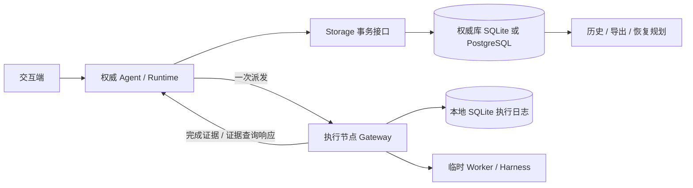

# 持久化设计原文快照：范围、职责与数据契约（1–5）

用途：规划上下文分片，避免 Trellis 单文件 32768 字节注入上限截断主设计；不是第二份权威设计。节选只调整相对链接以适配本目录，不改变原契约。

来源：[主设计](../../../../docs/architecture/agent-operation-persistence.md) 在 2026-10-18 文档修补后的工作树内容，代码兼容性基线 a078aa3。以下为对应章节原文（省略原文档一级标题）；开工前须对照当前主设计检查差异。主设计更新时应重新生成受影响分片，不以旧快照覆盖新契约。全部章节的整体关系见[父设计](../design.md)与[交付计划](../../../../docs/architecture/persistence-delivery.md)。

---

状态：核心方向及两原语简化已获用户同意：历史记录 + 检查点；fork 从安全检查点复制有效上下文并创建新 Agent，不设独立 branches 模型。仅设计，尚未实现。

本提案承接 [10-15 分布式架构归档](../../../../.trellis/tasks/archive/2026-10/10-15-distributed-agent-architecture/design.md) 中延期的持久化与恢复议题。它扩展而不改变 Operation / Execution / Result 的区分、显式权威、Harness 独立性、单次执行和不确定时不自动重试的原则。当前代码仍为内存实现；不得将这里的表、接口或保证解读为现有能力。

配套材料：[术语](../../../../GLOSSARY.md)、[实施与验收计划](../../../../docs/architecture/persistence-delivery.md)、[外部机制调研与简化决策](../../../../docs/architecture/research/durable-agent-mechanisms.md)。

## 1. 目标与保证边界

需要支持：

1. Agent 及其 Operation 的持久身份、已接受输入、完整业务历史和有效上下文。
2. 权威进程或同一权威节点重启后恢复；显式继续未完成轮次。
3. 无须启动 Agent 即可审阅历史、检查执行证据、导出轨迹。
4. 回到安全检查点创建独立的新 Agent，复制有效上下文后继续推理；原 Agent 的历史始终可审阅。
5. 使用 Ecto；权威库默认 SQLite，可选 PostgreSQL；执行节点的本地日志默认 SQLite。
6. 持久数据全部是可版本化的数据，禁止 PID、reference、闭包、端口、进程字典、任意 struct 和客户端对象。

不承诺：分布式共识、自动故障转移、数据库跨节点复制、跨库原子事务、外部副作用 exactly-once、环境迁移、模型逐 token 的确定性重现、撤销文件/数据库/API 等外部真实改变。

单个逻辑权威及其数据库是唯一业务事实源。PostgreSQL 可以是权威专属的数据库服务；“存储在权威节点”指权威拥有并独占写入该数据集，执行节点不直接访问它。SQLite 则使用权威本机持久卷。若要求 PostgreSQL 物理同机，部署为本机实例即可。

部署必须保证同一个 `authority_id` 同时只有一个活动主机写入，禁止同时启动原节点和数据库副本。库内版本检查用于本地并发与旧进程隔离，不是跨分区 fencing 或自动接管协议。失去磁盘或数据库且无可用备份时，不能凭执行节点日志重建全部 Agent 历史。

## 2. 已核对的现状与必要变化

| 当前实现 | 本提案要求 |
| --- | --- |
| Agent.Server 的 messages、turn、pending、results 等在内存中 | 显式领域记录、检查点、输入与结果消费记录 |
| Agent.Ref 含 PID 和 VM 内 reference；Discovery 只列活跃实例 | 新增持久 ID；活跃 Ref 仍只定位一个进程实例；历史查询独立于 Discovery |
| Runtime 的 Operation ID 为数据；Execution 还含 endpoint PID、incarnation、handle | 保留业务 ID，新增持久 attempt ID、executor ID、运行代次；句柄绝不落库 |
| Coordinator 在内存中接受一次终态，保留期后消失 | 一次终态接受改由数据库条件更新与唯一约束保证 |
| Operation.credentials、ModelBinding.credentials 为显式临时输入 | 可恢复定义必须使用 secret/profile 引用，凭据仅在调用时解析 |
| Gateway 的 admission、tombstone、worker 账本均不持久 | 执行前本地落盘；重启后能回答既有 attempt 的证据查询 |
| Agent Display 是有界 live-context 投影，允许截断、省略，注解使用运行态 reference | 只从完整业务数据写历史/检查点；恢复后重建展示，不保存投影或其身份 |
| Node/Runtime observations 是非原子的建议性观察；Node services ready 仅表示本地注册存在 | 保留现有观察语义；持久准入另受数据库提交与日志可用性约束 |
| Gateway 按首个停止触发原因分类已观察的 worker 停止；Coordinator 保留执行来源终态 | 执行日志与证据保留停止原因及观察结果，不用取消请求重写 deadline/success |
| Agent/provider/gateway 失效后不重放业务 | 维持该原则；恢复基础设施和状态不等于重执行 handler |

兼容性核对基线为 `a078aa3`，覆盖 `e9bd6b4`（停止原因）、`8eb3683`（Runtime observation）、`0a1b1de`（Agent display）及 `0c316bc`（Node observation）。这些变化未改变业务状态归属，也未新增 durable 能力；两个新增原语及现有表数保持不变。

证据文件：`apps/beamlet_agent/lib/beamlet/agent/server.ex`、`model_binding.ex`、`ref.ex`、`display.ex`，`apps/beamlet_runtime/lib/beamlet/runtime/operation_coordinator.ex`、`executor_gateway.ex`，`apps/beamlet_node/lib/beamlet/node.ex`、`observation.ex`，以及 [当前存储指南](../../../../.trellis/spec/backend/database-guidelines.md)、[Runtime 契约](../../../../.trellis/spec/backend/operation-runtime.md)。

当前 `turn`、peer request、delegation group 等使用 `make_ref()` 的关联，必须获得独立的持久字符串 ID，不能对 reference 编码后保存。已有进程无法事后承诺历史完整；切换前启动的 Agent 只能保持临时模式，或在显式静止点导入上下文并标记 `history_complete=false`。

## 3. 架构选择：事务状态与追加历史

采用“规范化当前状态 + 不可变业务事件 + 可恢复检查点”。不把完整 GenServer state 序列化，也不要求通过从头重放事件运行整个业务系统。

- 当前状态负责查询、约束和决策，事件负责审阅、追因和导出。
- 每次领域转换在一个权威数据库事务中同时写状态、事件和必要检查点。提交前不得对外声称成功。
- 检查点携带有效上下文和明确的继续位置；加载时只核对其引用和已有 Operation 状态，任何纯数据转换都不能调用模型、Tool 或网络。
- 所有会影响恢复的事实必须可靠落盘。流式 token、临时展示进度允许有界抽样或丢弃，最终模型回复和完整合法 Tool 参数必须保存。
- 每次改变 Agent 可恢复位置时，同事务保存一个完整的检查点描述；完整指逻辑自足，可以引用不可变 message/artifact，而不必复制全部消息内容。Operation 的观察变化保存在其当前记录和事件中，结果消费时再推进 Agent 检查点。
- 恢复直接读取检查点及其引用的 Operation/证据，不要求从头重放事件。首版检查点或引用损坏则明确阻塞；从旧检查点重建属于可选修复工具，不是运行时的另一条恢复路径。

这比只存快照多了审计能力，又避免全面 event sourcing 的事件归约器、重放与代码版本约束。需要兼容的是检查点与历史数据格式，不是旧 handler 的执行环境。



### 3.1 应用职责及依赖

建议新增一个 `beamlet_storage` 应用，集中 Ecto Repo、schemas、迁移、严格 JSON codec 与具体存储函数。它不启动 Agent、不派发 Operation、不依赖 Runtime / Agent / Harness / Phoenix。不另外建立通用 Storage behaviour、Document 系统或事务 bundle DSL。

```text
beamlet_actions -> []
beamlet_storage -> [Ecto, ecto_sql, ecto_sqlite3, postgrex]
beamlet_runtime -> [beamlet_actions, beamlet_storage]
beamlet_harness -> []
beamlet_agent -> [beamlet_actions, beamlet_runtime, beamlet_harness, beamlet_storage]
beamlet_node -> [上述组合所需应用]
beamlet_web / beamlet_cli -> [Agent 公共命令与历史接口]
```

Runtime 拥有 Operation/Execution 转换规则和本地证据协议，Agent 拥有上下文、fork、委派与恢复策略。Storage 内部分为 AgentRecords、OperationRecords、ExecutorJournal 三组具体函数；调用方传入已验证的数据与版本，内部使用现成的 Ecto.Multi 完成必要的跨表事务。它们不是三个可插拔框架，不提供任意 SQL/Repo 给 UI，也不解释 Tool 或模型语义。Agent 与 Runtime 使用同一个权威 Repo，结果接受和消费仍可分成两个各自原子的事务。

### 3.2 原语预算

新增的 durable 原语只有两项：**历史记录、检查点**。Agent、Operation、Execution 与 Result 沿用原架构；执行证据是带身份的记录值。fork/回撤是从检查点创建新 Agent 的操作，不是独立实体。secret ref、command_id、代次和继续位置均为已有对象的字段，不是新的可调度实体。

不增加独立 Branch 实体、父前缀递归解析、Task/Workflow、Effect、通用 Document、replay-safe 分类、独立 stream、inbox/outbox、lease、通用调度器或恢复引擎。恢复是现有 Agent 状态机的加载路径；证据核对是 Runtime 的查询路径；导出是历史记录的序列化。物理表与私有辅助函数不等于公共原语，增加它们仍须说明具体用途。

SQLite 与 PostgreSQL 是同一 SQL 实现上的两种 Ecto adapter，不另建两套领域 backend。显式定义 SQLiteAuthorityRepo / PostgresAuthorityRepo（adapter 在编译时确定），由组合层在启动时选择一个；ExecutorJournalRepo 独立。库的加载不自动启动 Repo、创建文件或执行 migration。临时模式继续可用，但持久 Agent 必须运行在持久 Runtime 上；不得在写库失败时偷偷降级到内存。

### 3.3 Live display / observation 不进入恢复事实源

`Agent.Display` 只展示 `live_context` 的有界替换式投影，不是 transcript，也不能作为模型输入。entries、activities、字段内容以及整个 display 都可能因预算省略；缺失 display 不能理解为保留上次快照。活动 `pending` 只说明取得 Runtime Ref，不证明 executor 已接纳或启动；placement 未被实际观察时仍为 unknown。

因此不订阅 display/snapshot 再落库，不把 `display_entries`、activities、subscriber credits 或注解 reference 放进检查点。历史、恢复、导出与 fork 使用完整规范化业务数据；恢复/fork 后为展示重新生成注解和运行身份。可选 `display_metadata` 的公开 title/preset/option 标签若需保存，须转成受严格 codec 校验的字符串键数据；这些标签不是配置、授权或 secret 保护，不能替代实际模型/Tool/环境定义及其引用。

Node/Runtime observation 同样只用于当前观察：报告可能过期、不可达或不完整，可用容量不是资源预约；它们不能证明旧执行未发生或已停止，不能授权恢复重发。保持现有非原子、有界只读语义，不增加 observation 历史表或恢复调度器。持久准入与运行注册状态的区分见第 11 节。

## 4. 数据契约与身份

### 4.1 持久身份和运行身份分离

- `authority_id`：安装/数据集的稳定 UUID；BEAM node name 只是可变化的路由配置。
- `agent_id`：不可复用的 UUID；现有可读 id 保留为 authority 内的别名。删除后旧记录不得误指同名新 Agent。
- `turn_id`、`operation_id`、`attempt_id`、`command_id`、`checkpoint_id`、`message_id`：不透明 UUID。Operation ID 继续使用不可复用随机 ID 即可，不要求改名其领域概念。
- `executor_id`：执行节点磁盘数据集稳定 ID；`executor_boot_id` 每次 Gateway 运行生成，编码为字符串。
- `agent_generation`：同一 Agent 每次激活/冻结后的本地写入代次，结合 `expected_version` 拒绝旧实例写入。
- PID、monitor、timer、当前 endpoint、资源槽占用、subscriber credits、活跃 Ref：只在内存重新建立。

调用方可保存持久 locator，但须通过显式 `restore` / `lookup` 获取新的活跃 Ref。旧 Ref 永远不会自动指向新进程。将 node name 从磁盘读为字符串后只通过受信任部署映射解析，禁止 `String.to_atom`。

### 4.2 可持久化数据

独立的严格 codec 接受字符串键的 JSON 数据、有限数值、布尔、null、数组；校验 UTF-8、深度、总字节和 schema version。二进制大对象进入 artifact；枚举保存约定字符串。禁止通过 Erlang external term、`inspect`、`term_to_binary` 或任意 struct dump 绕过约束。

Operation 的持久描述包含 kind、protocol version、业务 payload、能力/环境引用、claims、预算和安全 metadata；不含 credentials、handler MFA、settings 里的活对象。原始执行参数不可静默截断。若其内容无法在策略允许下持久保存，则拒绝持久提交，不能仅存 hash 后声称可恢复。

Agent 定义保存 provider/profile ID、版本化非秘密配置、catalogue/tool schema 快照及 digest、context policy/version、environment ref、secret ref。恢复时重新解析本地受信任注册表和凭据；缺少依赖或 schema 不兼容进入 `blocked`。配置变化不可静默改变未完成工作的语义；必须经显式重绑定命令记录差异。secret ref 不含密钥值，凭据轮换不保证重现原模型结果。

上下文需要保留实际发给模型的规范化 messages、Tool schema、策略输出及其 digest；保存规范化模型完整回复和用量/可用 provider request ID。私有思维链不作为所需轨迹；仅保存系统本来可观察的数据。通用数据校验无法识别嵌在文本中的所有秘密：持久模式必须使用明确内容策略，保护数据库/备份，并由提供者避免把凭据写入输出。

## 5. 最小数据模型

以下为首版八张权威表的职责草案，不要求为了每个领域名词建立表。Result 仍是共享值，turn/message/关系保存在历史中，继续位置保存在检查点中。不设 branches 表，Agent 直接拥有 head checkpoint。

| 表 | 核心内容及约束 |
| --- | --- |
| `agents` | 稳定 ID、authority_id、alias、定义、head_checkpoint_id、generation、lock_version、history_seq；可空 forked_from_agent_id/forked_from_checkpoint_id 只记录来源；authority+alias 唯一 |
| `checkpoints` | agent/turn ID、消息引用、pending Operation/有序 join/消费集合、继续位置、数据版本、digest、safe_to_fork；不可变 |
| `events` | scope_id、seq、type/version、turn/operation/因果 ID、payload、可空 dedupe_key、recorded_at；继承消息可含 source_agent_id/source_event_id；唯一(scope_id, seq)及(scope_id, dedupe_key) |
| `operations` | immutable description、可空 owner agent/turn、tool_call_id/ordinal、accepted_result、版本；独立 Operation 另有 history_seq |
| `executions` | attempt_id、operation_id、目标 executor/boot ID、prepared/send_claimed、观察状态、预算；已取得的停止原因及终止观察由证据/事件留痕；operation_id 唯一，最多一次尝试 |
| `execution_evidence` | receipt 身份、digest、内容和解决决定；来源+evidence_id 唯一，明确区别于 accepted_result |
| `commands` | scope、command_id、请求 digest、可重读响应；同 ID 同参数幂等，不同参数冲突 |
| `artifacts` | 内容/digest/media type/size；与引用同库提交；初版不自动 GC |

`authority_id` 保存在数据库安装元数据中，不需要 authority 领域实体。Agent 的 history_seq 或独立 Operation 的 history_seq 通过同事务 CAS 分配历史序号，不设 streams 表。Agent 所属 Operation 共用 Agent 的历史顺序；多个 Agent 没有全局顺序。事件包含完整业务内容，message 是其中具有角色/内容的记录；轮次列表按 turn_id 建索引查询。委派/peer 关系也使用带双方稳定身份的事件，未决集合保存在检查点中。

结果消费的去重键为 `agent_id + operation_id + consumption_kind`，由 events 唯一约束和检查点 CAS 一起保证。除有去重需求的转换外，dedupe_key 为空；两库均须验证该唯一约束行为。每个 Agent 只允许一个活动轮次，通过 Agent 版本更新实现。

事件覆盖输入、实际模型请求/完整回复、Tool 请求/结果、派发与执行观察、终态接受/消费、暂停/恢复/回撤决定及委派观察。可丢失 progress 不是必需恢复事实。统计/轮次/消息列表先用这些记录查询；测量证明确有必要时再加投影，不能同时维护第二份权威 transcript。

执行节点首版仅需 `journal_attempts`：以 authority_id+attempt_id 唯一，保存 operation ID、描述 digest、executor/boot ID、start_intent/terminal/unknown、已记录的首个停止触发原因（deadline/cancelled，可空）、终止观察、终态值和稳定 receipt_id、权威持久接收确认。终态重复上报用相同 receipt_id；不建立通用证据流或独立队列。日志不能修改权威 Result 或上下文。
