# Beamlet Architecture

[English](architecture.md) | [简体中文](architecture_zh.md)

> **Status:** Accepted architecture baseline for the first version. This document describes the intended system, not an already implemented product. Application names, exact interfaces, and operational limits may be refined during implementation without changing the responsibilities described here.

Beamlet is an Elixir/OTP system for running AI Agents across a trusted BEAM cluster. A user selects the node that maintains an Agent's reasoning loop; the work that loop requests can run on other eligible nodes.

The architecture separates three concerns: **deciding what to do, executing the work, and presenting the interaction**. Its distributed execution layer is general-purpose and can also serve callers that have nothing to do with AI.

The follow-up [Agent / Operation persistence proposal](docs/architecture/agent-operation-persistence.md) (Chinese; core direction accepted, research refinements documented) extends this baseline with Ecto storage, recovery, history, export, and rewind. It uses history records and checkpoints as its two added durable primitives; fork copies effective context into a new Agent rather than introducing a branch entity. Its scope and guarantees are separate from the in-memory first version below.

## Contents

- [1. Goals and operating assumptions](#1-goals-and-operating-assumptions)
- [2. System overview](#2-system-overview)
- [3. Application structure](#3-application-structure)
- [4. Agent, Harness, and integration adapters](#4-agent-harness-and-integration-adapters)
- [5. Node roles and deployment](#5-node-roles-and-deployment)
- [6. Discovery and placement](#6-discovery-and-placement)
- [7. Operation and execution model](#7-operation-and-execution-model)
- [8. A complete Agent turn](#8-a-complete-agent-turn)
- [9. Streaming and user interfaces](#9-streaming-and-user-interfaces)
- [10. Cancellation and failure semantics](#10-cancellation-and-failure-semantics)
- [11. OTP process ownership](#11-otp-process-ownership)
- [12. Scope and future evolution](#12-scope-and-future-evolution)
- [13. Design rationale and references](#13-design-rationale-and-references)

## 1. Goals and Operating Assumptions

The first version should make it straightforward to start an Agent in a cluster, dispatch its LLM requests and Tool calls, and return progress and results to its authority node.

The design prioritizes:

- Reusable libraries with explicit, acyclic dependencies inside a Mix umbrella.
- A generic operation runtime, independent of Agent, Tool, model-provider, and UI semantics.
- Harness implementations that do not need to know about the distributed operation system.
- Independently configurable interaction, authority, and execution roles.
- Native BEAM/OTP mechanisms rather than mandatory external infrastructure.
- Honest failure reporting rather than durability or availability guarantees the system cannot provide.

All participating nodes belong to one trusted BEAM cluster. No external database server or message broker is required. Runtime state is held in memory; losing an Agent or its authority node is not transparently recoverable in this version.

## 2. System Overview

A typical deployment uses three nodes, although all roles can share one node:

```mermaid
flowchart LR
    subgraph node_a["Interaction node A"]
        ui["Phoenix / another user interface"]
    end

    subgraph node_b["Authority node B"]
        direction TB
        agent_loop["Agent Loop: conversation and decisions"]
        caller_adapter["Caller-side adapter"]
        coordinator["OperationCoordinator: placement and observation"]
        agent_loop --> caller_adapter --> coordinator
    end

    subgraph node_c["Execution node C"]
        direction TB
        gateway["ExecutorGateway: local admission"]
        worker["Temporary worker: execution-side adapter"]
        harness["Harness implementation: model / Tool / environment"]
        gateway --> worker --> harness
        harness -.->|"Return value / progress"| worker
        worker -.->|"Progress / result"| gateway
    end

    ui -->|"Commands"| agent_loop
    agent_loop -.->|"Events"| ui
    coordinator -->|"Dispatch via Distributed Erlang"| gateway
    gateway -.->|"Progress / result"| coordinator
    coordinator -.->|"Progress / result"| caller_adapter
    caller_adapter -.->|"Normalized observations"| agent_loop
```



The Agent decides which operation is needed. The runtime chooses where it may run and manages its execution. An adapter translates between AI-facing interfaces and generic operation contracts. The UI issues commands and displays observations; it does not own the Agent loop.

There is no cluster-wide singleton scheduler. Each submission has its own coordinator, and each execution node controls admission to its local resources.

## 3. Application Structure

The planned application structure has six applications. The existing package name `beamlet_actions` is retained; its domain contracts use Operation and Execution, not a separate Action abstraction. This document revision does not rename application code.

| Application | Owns | Does not own |
| --- | --- | --- |
| `beamlet_actions` | Operation and Execution contracts, shared Result values, live handles, events, and the handler behaviour | Processes, placement, AI semantics, UI, or storage |
| `beamlet_runtime` | Submission, discovery, placement, admission, supervised execution, progress, results, and cancellation | Tool catalogues, prompts, model-provider formats, or environment synchronization |
| `beamlet_harness` | Backend-neutral Tool/model interfaces, catalogues and schemas, context policies, environment and sandbox integrations | Operation types, runtime registration, or Agent-loop orchestration |
| `beamlet_agent` | Agent lifecycle and loop, concurrent operation orchestration, Sub-agent delegation and peer interaction, UI-independent commands/events, and isolated operation integration adapters | Concrete model HTTP clients, sandbox implementations, or Phoenix |
| `beamlet_node` | Product composition: role configuration, selected supervision trees, handler registration, provider wiring, and readiness | The execution engine or reasoning policy |
| `beamlet_web` | Phoenix/LiveView presentation and adaptation of Agent commands and events | Agent-loop state, placement, or direct Tool execution |

### Dependencies

The arrows below mean **depends on**, not message flow:

```text
beamlet_actions  -> []
beamlet_runtime  -> [beamlet_actions]
beamlet_harness  -> []
beamlet_agent    -> [beamlet_actions, beamlet_runtime, beamlet_harness]
beamlet_node     -> [beamlet_actions, beamlet_runtime, beamlet_harness, beamlet_agent]
beamlet_web      -> [beamlet_agent, Phoenix/LiveView]
```

An empty list means no dependency on another Beamlet application; ordinary third-party dependencies are still possible.

The two critical restrictions are:

- The generic runtime does not depend on Agent or Harness.
- Harness does not depend on `beamlet_actions` or `beamlet_runtime`.

A non-AI caller can use `beamlet_actions` and `beamlet_runtime` directly. Conversely, a Harness Tool or model implementation can be invoked and tested locally without either application.

`beamlet_node` references the operation registration contracts it assembles, so they are listed as a direct dependency. It remains a composition root, not a second implementation of the runtime. Dependencies should follow actual interface usage rather than be kept merely because another dependency happens to include them.

## 4. Agent, Harness, and Integration Adapters

### Agent: reasoning and orchestration

An Agent owns its in-memory conversation, current turn, outstanding operations, and the correlations between Tool calls and their results. It determines whether to request model generation, execute Tools, continue the loop, or finish the turn.

The Agent is a responsive OTP process, conceptually a `GenServer` with explicit state. It is not Elixir's `Agent` state container, and it does not block a state-management callback for the duration of an LLM request, Tool invocation, or another Agent's work. `:gen_statem` is an alternative if waiting/joining states become complex, not an additional required service.

### Concurrent work, Sub-agents, and peer Agents

One Agent may submit several independent Operations; several Agents may do so concurrently. Each Agent serializes its own state transitions, not all outstanding work. Results are correlated by Operation, Tool-call, delegation, and turn identity rather than arrival order. Independent work still respects local capacity and environment exclusivity. Distinct proposed solutions are distinct Operations, not retries of the same Operation.

Sub-agents are ordinary Agent processes started on an explicitly selected authority-ready node through `DynamicSupervisor` and local `Registry`. A parent delegates through the Agent interface and tracks the delegation and child AgentRef; peer Agents exchange correlated messages through that same UI-independent interface. Creation/acceptance may use short bounded requests, but completion is asynchronous. The Agent layer owns delegation, bounded messages, waiting/joining rules, and result interpretation; the generic runtime has no parent/child or conversation semantics.

Business parenthood is not an OTP supervision link. A shared authority supervisor can host parent, child, and peer Agents; monitors observe failures without directly linking their lifetimes. Delegated work belongs to the delegating turn: stopping that turn or observing delegator loss requests a stop of the delegated child turn. Peer lifetimes are independent unless explicitly delegated. Cleanup is best effort, and late replies cannot advance a stopped or later turn. Remote disconnection reports unavailability, not proof that an Agent or its work stopped.

A Sub-agent is not an Execution worker. Its own model/Tool work uses Operations through the runtime adapter. Waiting for a child reply is Agent state and must not reserve the execution slots that child work needs. A bounded request/reply integration may expose Agent work as an Operation, but this does not replace the Agent interaction protocol or require all peer messages to become Operations. No human-input handler or generic callback/completion system is introduced.

Native mechanisms are sufficient for this in-memory interaction: `GenServer`/optional `:gen_statem` for state, `DynamicSupervisor` for Agent lifecycle, ordinary messages and monitors for communication, local `Registry` for authority lookup, and `:pg` for service discovery. Discovery is not global identity or exclusive ownership. Mailboxes and display output need bounded producer concurrency/rates; asynchronous messaging is not automatic backpressure or durable delivery.

### Harness: capabilities and context

Harness supplies the things that vary between Agent deployments:

- Tool names, descriptions, argument schemas, and native invocation interfaces.
- Model request/reply contracts and provider implementations.
- Context and prompt construction policies.
- Environment references and workspace, session, or sandbox implementations.
- Backend-neutral hooks for intermediate output and cancellation.

Harness authors do not construct Operation structs, manage OperationRefs, implement the operation-handler behaviour, or assign runtime resource-pool keys.

A Harness is not necessarily one long-running process. Catalogue and context functions may run on the authority node, while concrete model or Tool operations are invoked on execution nodes. Provider descriptions must not require starting a sandbox or accessing execution credentials merely to inspect a catalogue.

### Adapters: translation without leaking runtime concepts

The integration adapters live in an isolated module group inside `beamlet_agent`, separate from the loop itself. They perform two complementary jobs:

1. **Caller side:** translate model/Tool invocations and native environment needs into operation descriptions, capability requirements, and resource claims; translate results into Agent observations.
2. **Execution side:** implement generic operation handlers, invoke Harness interfaces, and translate native progress/cancellation hooks into runtime events/control.

An executor can load these handler modules without starting an Agent process. Keeping the adapters in the Agent application does not assign the authority role to every node that loads that application.

## 5. Node Roles and Deployment

Roles are declared when a node registers and may be combined freely:

| Role | Runs | Does not require |
| --- | --- | --- |
| Interaction | A UI or client integration that sends commands and subscribes to observations | An Agent loop or operation executor |
| Authority | Agent processes, authority-local lookup, and coordinators for their operations | Local model or Tool execution |
| Execution | An executor gateway, worker supervision, and configured providers | An Agent loop or UI |

A physical BEAM node is not the `beamlet_node` application. The latter starts and configures the product services; the execution mechanism running on an execution node belongs to `beamlet_runtime`.

Reusable libraries expose interfaces and child specifications rather than automatically starting every service they contain. `beamlet_node` starts the configured role subtrees. `beamlet_web` is a separate application and release entry point for web interaction deployments.

The initial release arrangement can use one product-node release configured at boot, plus a release that also starts the web application. Executor deployments need not include Phoenix. This does not promise a minimal library artifact for each role: actual Mix release dependency closure and application startup must be verified during implementation.

### Establishing the cluster

Nodes must be connected before distributed work can run. Static configuration or explicit connection is sufficient for the first version. `:pg` discovers endpoints on connected nodes; it is not a cluster-connection mechanism, and membership visibility should not be assumed across nodes lacking a direct connection.

The system does not require automatic cluster discovery, global Agent naming, leader election, or a consensus-backed directory. Roles describe deployment capabilities, not permissions between trusted nodes.

## 6. Discovery and Placement

Each node publishes a bounded report describing:

- Its node address and endpoint incarnation.
- Declared roles and services that are actually ready.
- Supported handler protocols and capability labels.
- Environment access labels supplied through integration/deployment configuration.
- Local capacity-pool totals and current availability.
- Optional advisory host information, such as CPU, memory, or GPU labels.
- A report revision; receivers measure freshness using their own receive time.

Reports never contain credentials, open provider clients, live filesystem handles, or copies of a workspace. A provider-profile label may identify access to credentials configured only on an executor.

A dedicated `:pg` scope supports endpoint discovery. Local directories obtain initial reports, consume refreshed snapshots, and invalidate entries on membership changes, endpoint loss, or expiry. This is an ephemeral cache, not a replicated database or an atomic cluster-wide resource inventory.

### Placement and admission are different decisions

The coordinator filters targets by execution readiness, handler compatibility, capabilities, environment access, explicit node constraints, report freshness, and reported capacity. A simple utilization preference and stable tie-break are sufficient; an optimization engine is unnecessary.

The selected executor then checks its **current local state** and charges capacity before starting the worker. Reports guide placement; local admission determines whether execution can start. Application-level capacity pools enforce concurrent slot limits, not physical CPU or memory isolation.

If no target is eligible or the selected executor definitely rejects admission, the caller receives an explicit result. The first version does not need a queue, automatic re-placement, preemption, fairness guarantees, or cluster-global reservations. A timeout while requesting admission is ambiguous and is not a definite rejection.

### Environment locality

Capability support, environment access, and available capacity are separate requirements. Supporting a Shell Tool does not make a node eligible to use another node's Shell session.

Harness describes its environment in native terms. The integration adapter maps those needs to opaque placement constraints and, where appropriate, node-local exclusive slots. Runtime does not need to understand filesystem or sandbox internals.

Beamlet does not synchronize, replicate, migrate, or reconstruct environments. It never substitutes an unrelated environment just because the intended executor is unavailable. If a deployment exposes one shared environment on several nodes, its provider/deployment owns synchronization and cross-node mutual exclusion; a shared path alone does not make concurrent mutation safe.

## 7. Operation and Execution Model

There are two core entities: **Operation** and **Execution**. **Result** is a shared terminal-value representation, not a third independently managed entity. Events describe intermediate progress and observations, not terminal Results.

| Concept | Meaning |
| --- | --- |
| Operation | A structured data description of one requested operation: registered operation/protocol identifier, bounded payload, placement requirements, resource claims, time budget, and correlation metadata |
| Execution | One identified attempt to perform an Operation; distinct from its worker process, it may be awaiting admission, running, completed, or uncertain |
| Result | A terminal value expressing success, failure, rejection, cancellation, timeout, or loss/unknown, with cause, bounded return data, and source information where applicable |

Operation is independent of Agent, user input, and natural-language intent. It is the operation description itself, not a wrapper around another OperationSpec. Its requested meaning is fixed for a submission. Live PIDs, monitor references, HTTP clients, open sessions, and executable closures belong to execution context, not the description. This is not a persistence format or a promise of future schema compatibility.

### Results and acceptance

An Execution can produce a Result. The OperationCoordinator may accept that same Result as the Operation's terminal result; it does not copy it into a separate Outcome entity. An execution-origin Result identifies its Operation and Execution. Receiving an execution Result is not itself acceptance: the coordinator validates its identity and current state, records the accepted value in memory, and ignores duplicate/stale reports after termination.

The coordinator can also form a Result without an execution return value: no eligible target, definite non-admission, cancellation before dispatch, deadline expiry, or lost observation. Source information distinguishes coordinator-origin Results from execution-origin Results; no synthetic Execution is needed when no attempt was dispatched. A cancellation request alone is not a terminal Result. Timeout/loss does not prove remote termination.

```text
Operation
  ├─ Execution → Result
  └─ accepted_result → that Result, or a coordinator-origin Result
```

This version permits at most one Execution attempt per Operation, including an attempt whose admission becomes uncertain. No automatic retry, re-placement, or competing attempts are added. Several independent Operations can execute concurrently. The model can later represent additional attempts, but their admission/safety and selection policy are outside this version. One locally accepted Result does not imply exactly-once side effects.

### Live references and process ownership

| Concept | Responsibility |
| --- | --- |
| OperationRef | Identifies one submission and its live coordinator/address incarnation |
| Execution identity | Correlates an attempt with its Operation, including before confirmed admission |
| Execution handle | Identifies an admitted worker at a particular executor incarnation |
| OperationCoordinator | Places an Operation, observes its Execution, handles control, and accepts its terminal Result |
| ExecutorGateway | Enforces node-local admission and manages its workers |
| Worker | Runs one registered handler invocation as a temporary supervised process |

References and execution handles are ephemeral, not persistent IDs or recovery records. An old reference must not silently resolve to a replacement execution after a restart.

### Caller interface

The conceptual interface has three operations; these are not final Elixir signatures:

| Operation | Meaning |
| --- | --- |
| `submit(operation, owner_and_event_sink)` | Create a local coordinator and return an OperationRef; this is not remote admission or success |
| `cancel(operation_ref)` | Request cancellation or report an already-terminal condition; it is not confirmation of remote termination |
| `status(operation_ref)` | Inspect a live or briefly retained result, or report that the reference is unavailable/expired |

The event sink is installed as part of submission to avoid racing a separate subscription against a fast completion. Invalid submissions or exhausted coordinator capacity may fail immediately. Placement and execution results arrive asynchronously. Terminal state is retained only for a bounded interval, not as durable history.

The coordinator monitors its owner and requests cleanup if that owner disappears. Executors monitor coordinator ownership and attempt local cleanup when ownership loss is observed. These are best-effort lifetime policies, not partition-proof execution control.

### Worker execution

The gateway starts a local temporary task through `Task.Supervisor.async_nolink`, using an explicit wrapper entry point. It owns task handles and processes result and monitor messages. Registered handlers receive local execution context for resolved provider resources, progress emission, and cancellation support. The wrapper/gateway normalizes handler returns and observed worker failures into the shared Result representation; acceptance still belongs to the OperationCoordinator.

Operation deadlines are measured on the coordinator's monotonic clock. The executor receives a remaining duration; absolute monotonic timestamps from different nodes are not compared as though they share a clock.

## 8. A Complete Agent Turn

Consider UI node A, user-selected authority node B, and executor C:

1. A requests an Agent on B and receives an AgentRef identifying B and the live Agent incarnation. B enforces local identity uniqueness; no cluster-global uniqueness or relocation is implied.
2. The Agent builds model context using Harness catalogue/context interfaces.
3. Its adapter submits model generation to a coordinator on B.
4. The coordinator selects an eligible executor. C checks current capabilities and local capacity, then starts a worker.
5. C's execution adapter invokes the Harness model provider. Optional deltas return through the runtime and Agent to A.
6. The final normalized model reply returns to B. The Agent uses that reply, not the displayed deltas, to advance its state.
7. If the reply requests Tools, complete arguments are validated against catalogue schemas. The adapter creates operations with the appropriate environment and capacity requirements.
8. Tool results are correlated by Tool-call ID, converted to model observations, and used for the next model step or the final response.

Partial streamed Tool-call arguments are never executable. If independent calls run concurrently, their results are correlated by identity rather than arrival order, and local resource/environment restrictions still apply.

An executor D that supports the same Tool but lacks the required environment is not a candidate. An authority-only B does not silently execute the operation itself if C is unavailable. When all roles share a node, local execution still uses the same gateway and admission checks.

### Parallel delegation

Agent P can delegate independent requests to Agents Q and R on explicitly selected authority nodes. Each child submits its own model/Tool Operations through the normal runtime path; P waits asynchronously without holding child-required execution slots. Q and R return replies correlated to their delegations and P's turn. P joins them according to Agent policy, not arrival order, and remains responsive to control. Stopping P's turn requests a best-effort stop of the delegated child turns; late replies cannot advance a later turn. Peer exchanges use the same correlated messaging seam without implicitly establishing parent/child lifetime ownership. Agent failure/disconnection is observed, not transparently recovered.

## 9. Streaming and User Interfaces

The output path is:

```text
worker -> executor gateway -> operation coordinator -> Agent -> UI subscribers
```

Provider output from other processes is marshalled through the worker wrapper before emission. The gateway forwards progress and completion through the same logical operation stream; arbitrary cluster processes are not assumed to share message order. Operation-local sequence information helps identify gaps or stale messages but does not provide reliable delivery.

Intermediate events and terminal results are distinct. Output size and forwarding volume are bounded; progress may be batched or coalesced. Raw stdout and token callbacks must not create an unconstrained stream. Tool output may be truncated with an explicit indication. Final model output is assembled on the execution side and returned independently of display events.

The Agent exposes UI-independent start, input, snapshot, subscription, unsubscription, turn-stop, work-delegation, and correlated Agent-message operations. A subscription receives an initial bounded snapshot and subsequent events through the same sink/channel, in that order. A separate command acknowledgement is not the snapshot barrier.

UI disconnection removes the subscription, not the Agent. Reconnection obtains a fresh snapshot; missing intermediate events are not replayed. A slow UI must not block the reasoning loop. Session/context state remains bounded and in memory.

Ordinary monitored process messages are sufficient for initial subscriptions. Phoenix.PubSub is an optional future fan-out mechanism, not a core dependency. Phoenix/LiveView, CLI, and IEx clients consume the same Agent interface.

## 10. Cancellation and Failure Semantics

The runtime reports what it knows, including when it cannot determine what happened remotely:

| Observation | Interpretation |
| --- | --- |
| Rejected | No eligible target or a definite non-admission by the selected executor |
| Succeeded / failed | A definite handler result or an observed worker failure while observation remained intact |
| Cancel requested | A control request has been accepted; the work may still be running |
| Cancelled | Cancellation prevented dispatch, or worker termination after cancellation was observed; external effects may remain |
| Timed out | The operation budget expired; remote stop may be unconfirmed |
| Lost / unknown | Admission or completion became unknowable through process loss or disconnection; execution or side effects may have occurred |

Cancelling before dispatch prevents the coordinator from starting work. During execution, the gateway attempts bounded local shutdown without blocking unrelated admission or event processing. Cancellation and completion can race: an accepted success is not rewritten by a later cancellation, and a real result may win even after a cancellation request was acknowledged.

A surviving coordinator accepts at most one terminal Result for its Operation, whether execution-origin or coordinator-origin, and ignores stale or subsequent reports. This is a local in-memory acceptance decision, not a durable or cluster-wide agreement and not a distributed exactly-once guarantee.

Stopping an Agent turn first prevents follow-on work, then requests cancellation of outstanding operations. Late results cannot resume that stopped turn or advance a later one. Stopping a BEAM worker does not promise to undo a filesystem change, terminate every OS child, or cancel an already accepted remote LLM request.

### No automatic replay after ambiguity

An ambiguous admission, timeout, or disconnection does not trigger an automatic retry or a new placement. Otherwise, a lost response could cause duplicate side effects. Provider integrations must also avoid implicit unsafe request retries.

| Failure | Intended behavior |
| --- | --- |
| UI/client disappears | Remove its subscription; Agent and work may continue |
| Worker crashes | Report observed failure; do not restart the operation from its inputs |
| Executor/gateway is lost | Report failure or loss according to available evidence; do not infer absence of side effects |
| Agent/authority disappears | The live Agent is lost; attempt owned-work cleanup when loss is observed; no other node takes over |
| A node returns | Register a new incarnation and fresh capabilities; old references do not regain validity |

## 11. OTP Process Ownership

The intended supervision shape is conceptual; exact strategies must be validated with failure tests:

```text
Beamlet.Node.Supervisor
  Runtime.SharedSupervisor                     all product nodes
    dedicated :pg scope
    NodeEndpoint                               role/capability/resource reports
    Directory                                  local endpoint snapshots
    OperationCoordinatorSupervisor             temporary coordinators
  Agent.AuthoritySupervisor                    authority role
    local Registry
    DynamicSupervisor                          temporary Agent processes
  Harness.ProviderSupervisor                   configured execution providers
    environment / session / sandbox children
  Runtime.ExecutionSupervisor                  execution role
    Task.Supervisor                            temporary operation workers
    ExecutorGateway                            admission and worker ownership

Beamlet.Web.Supervisor                         separate web application
  Phoenix Endpoint / LiveView supervision
```

Providers must be ready before their capabilities are advertised. Losing a provider withdraws relevant readiness and invalidates affected work.

The worker supervisor and gateway form a coupled infrastructure subtree: losing gateway accounting must not leave workers running while a replacement gateway advertises fresh capacity. Similarly, losing authority lookup infrastructure invalidates affected in-memory Agents rather than pretending their registrations/state can be reconstructed.

Infrastructure may restart, but Agents, coordinators, and operation workers are temporary. **OTP supervision is not business recovery:** restarting services must not automatically repeat LLM requests, Tool calls, or a conversation from its initial arguments.

The principal OTP mechanisms are `GenServer` (optionally `:gen_statem`), `DynamicSupervisor`, `Task.Supervisor`, local `Registry`, `:pg`, and process monitors. A local Registry is not a global Agent directory; `:pg` membership is not an atomic resource reservation. Agent supervision and business delegation are separate relationships; temporary Execution workers are not Agent lifecycle owners.

## 12. Scope and Future Evolution

The first version deliberately excludes:

- Agent/Operation persistence, checkpoints, replay, recovery, and durable queues.
- Operation review/approval workflows.
- Consensus, leader election, transparent authority migration, and automatic failover.
- Reliable-delivery or distributed exactly-once guarantees.
- Environment synchronization, replication, migration, and cross-node environment locking.
- Side-effect rollback guarantees.
- Human questions/replies represented as operations, waiting human-request handlers, or an external callback/completion protocol.
- Authentication/authorization between trusted cluster nodes.
- Mandatory external database servers or message brokers.

Ordinary user messages remain Agent commands; they do not complete a waiting human-input operation. That form of interaction may be revisited with future callback-related work, but no handler topology or input-routing mechanism is designed now.

Future work has room to evolve because Operation descriptions are separate from live execution context, Operation and Execution identities are distinct, Result acceptance has one local owner, and provider integrations sit behind explicit interfaces. Persistence, state recovery, and distributed consistency are deferred topics, not designed mechanisms in this revision. Do not add storage adapters, checkpoints, inboxes/outboxes, authority epochs, consensus protocols, review states, or a workflow DSL in anticipation of those features. Future durability work may require contract changes.

## 13. Design Rationale and References

| Decision | Why |
| --- | --- |
| Separate libraries and explicit dependencies | Keep execution reusable and prevent UI/provider concerns from spreading into the loop or runtime |
| Backend-neutral Harness plus integration adapters | Let capability authors work independently of distributed execution |
| Explicit authority references | Avoid solving global uniqueness and failover before they are needed |
| Per-operation coordination plus executor-local admission | Avoid a singleton scheduler while retaining clear resource ownership |
| Data descriptions instead of public remote closures | Make contracts explicit and keep runtime handles out of operation definitions |
| Temporary business processes | Avoid confusing supervision with safe replay of side effects |
| No external broker/database | Keep the first deployment lightweight and focused on cluster execution |

The accepted trade-offs are stale reports, explicit capacity rejection, incomplete progress, uncertain results after loss, and loss of an Agent when its authority fails. These limits are intentional and visible to callers.

Relevant primary documentation:

- [Elixir Task: distributed tasks](https://hexdocs.pm/elixir/Task.html#module-distributed-tasks)
- [Task.Supervisor](https://hexdocs.pm/elixir/Task.Supervisor.html)
- [GenServer](https://hexdocs.pm/elixir/GenServer.html)
- [Erlang generic state machines (`gen_statem`)](https://www.erlang.org/doc/apps/stdlib/gen_statem.html)
- [DynamicSupervisor](https://hexdocs.pm/elixir/DynamicSupervisor.html)
- [Registry](https://hexdocs.pm/elixir/Registry.html)
- [Erlang process groups (`pg`)](https://www.erlang.org/doc/apps/kernel/pg.html)
- [Erlang processes, signals, and monitors](https://www.erlang.org/doc/system/ref_man_processes.html)
- [Mix releases and umbrellas](https://hexdocs.pm/mix/Mix.Tasks.Release.html#module-umbrellas)
- [Phoenix.PubSub](https://hexdocs.pm/phoenix_pubsub/Phoenix.PubSub.html)
