# Beamlet 架构设计

[English](architecture.md) | [简体中文](architecture_zh.md)

> **状态:** 已确认的首版架构基线.本文描述预期设计,并不表示系统已经实现.应用名称,具体接口和运行参数可以在不改变职责划分的前提下,于实现阶段进一步细化.

Beamlet 是一个使用 Elixir/OTP 开发,可跨可信 BEAM 集群运行 AI Agent 的系统.用户指定某个节点维持 Agent 的推理循环,而循环所请求的工作可以安排到其他符合条件的节点执行.

架构将三个关注点分开:**决定做什么,执行具体工作,呈现交互过程**.其中的分布式执行层是通用的,也可以服务于与 AI 无关的调用方.

## 目录

- [1. 目标与运行假设](#1-目标与运行假设)
- [2. 系统总览](#2-系统总览)
- [3. 应用结构](#3-应用结构)
- [4. Agent 与 Harness 及适配层](#4-agent-与-harness-及适配层)
- [5. 节点角色与部署](#5-节点角色与部署)
- [6. 节点发现与动作放置](#6-节点发现与动作放置)
- [7. 动作执行模型](#7-动作执行模型)
- [8. 完整的 Agent 交互轮次](#8-完整的-agent-交互轮次)
- [9. 流式输出与用户界面](#9-流式输出与用户界面)
- [10. 取消与失败语义](#10-取消与失败语义)
- [11. OTP 进程归属](#11-otp-进程归属)
- [12. 范围与未来演进](#12-范围与未来演进)
- [13. 设计取舍与参考资料](#13-设计取舍与参考资料)

## 1. 目标与运行假设

第一版应当能够在集群中方便地启动 Agent,分发其 LLM 请求与 Tool 调用,并将进度和结果返回到权威节点.

设计优先考虑:

- 在 Mix umbrella 内建立可复用的库,依赖关系明确且无环.
- 提供独立于 Agent,Tool,模型提供者及 UI 语义的通用动作运行时.
- 让 Harness 实现者无需了解分布式动作系统.
- 支持独立配置交互,权威和执行角色.
- 优先利用 BEAM/OTP 原生机制,不要求用户维护额外的基础设施.
- 如实表达失败与不确定性,不承诺系统尚不具备的持久性或可用性.

所有参与节点都属于同一个可信 BEAM 集群.不要求外置数据库服务端或消息代理.运行状态保存在内存中;当前版本无法在 Agent 或其权威节点丢失后透明恢复.

## 2. 系统总览

典型部署使用三个节点,但所有角色也可以部署在同一节点:

```mermaid
flowchart LR
    subgraph node_a["交互节点 A"]
        ui["Phoenix 或其他用户界面"]
    end

    subgraph node_b["权威节点 B"]
        direction TB
        agent_loop["Agent Loop:对话状态与决策"]
        caller_adapter["调用侧适配器"]
        coordinator["ActionCoordinator:动作放置与结果观察"]
        agent_loop --> caller_adapter --> coordinator
    end

    subgraph node_c["执行节点 C"]
        direction TB
        gateway["ExecutorGateway:本地准入"]
        worker["临时工作进程:执行侧适配器"]
        harness["Harness 实现:模型 / Tool / 环境"]
        gateway --> worker --> harness
        harness -.->|"返回值 / 进度"| worker
        worker -.->|"进度 / 结果"| gateway
    end

    ui -->|"命令"| agent_loop
    agent_loop -.->|"事件"| ui
    coordinator -->|"通过 Distributed Erlang 派发"| gateway
    gateway -.->|"进度 / 结果"| coordinator
    coordinator -.->|"进度 / 结果"| caller_adapter
    caller_adapter -.->|"规范化后的观察结果"| agent_loop
```



Agent 决定需要进行什么操作.运行时决定操作可以在哪里运行,并管理其执行过程.适配器负责在 AI 侧接口与通用动作契约之间转换.UI 发送命令并展示观察结果,但不拥有 Agent Loop.

集群中不设置单例调度器.每次动作提交都有独立的协调进程,每个执行节点自行控制对本地资源的准入.

## 3. 应用结构

计划将系统划分为六个应用:

| 应用 | 负责 | 不负责 |
| --- | --- | --- |
| `beamlet_actions` | 动作描述,活跃运行句柄,事件,结果和处理器 behaviour | 进程,动作放置,AI 语义,UI 或存储 |
| `beamlet_runtime` | 提交,发现,放置,准入,受监督执行,进度,结果和取消 | Tool 目录,提示词,模型提供者格式或环境同步 |
| `beamlet_harness` | 执行后端无关的 Tool/模型接口,目录与 schema,上下文策略,环境和沙箱集成 | 动作类型,运行时注册或 Agent Loop 编排 |
| `beamlet_agent` | Agent 生命周期与循环,Tool Call 编排,交互接口,以及独立的动作集成适配器 | 具体模型 HTTP 客户端,沙箱实现或 Phoenix |
| `beamlet_node` | 产品组合入口:角色配置,选定监督树,处理器注册,能力提供者装配和就绪状态 | 执行引擎或推理策略 |
| `beamlet_web` | Phoenix/LiveView 展示层,以及 Agent 命令和事件的界面适配 | Agent Loop 状态,动作放置或直接执行 Tool |

### 依赖关系

下面的箭头表示**依赖于**,而不是消息流向:

```text
beamlet_actions  -> []
beamlet_runtime  -> [beamlet_actions]
beamlet_harness  -> []
beamlet_agent    -> [beamlet_actions, beamlet_runtime, beamlet_harness]
beamlet_node     -> [beamlet_actions, beamlet_runtime, beamlet_harness, beamlet_agent]
beamlet_web      -> [beamlet_agent, Phoenix/LiveView]
```

空列表表示不依赖其他 Beamlet 应用,并不排斥使用普通第三方库.

两条关键限制是:

- 通用运行时不依赖 Agent 或 Harness.
- Harness 不依赖 actions 或 runtime.

非 AI 调用方可以直接使用 `beamlet_actions` 和 `beamlet_runtime`.反过来,也可以在不加载这两个应用的情况下,直接调用和测试 Harness 的 Tool 或模型实现.

`beamlet_node` 会引用它所装配的动作注册契约,因此将其列为直接依赖.它仍然是组合入口,而不是另一套运行时实现.依赖应当体现实际使用的接口,而不是仅因为某个传递依赖已经包含对应库就隐式使用它.

## 4. Agent 与 Harness 及适配层

### Agent:推理与编排

Agent 拥有内存中的对话,当前轮次,尚未完成的操作,以及 Tool Call 与结果之间的关联.它决定何时请求模型生成,执行 Tool,继续循环或结束当前轮次.

Agent 是能够保持响应的 OTP 进程,在概念上可视为具有显式状态的 `GenServer`.它不是 Elixir 的 `Agent` 状态容器,也不会在状态管理回调中阻塞等待整个 LLM 请求或 Tool 调用结束.

### Harness:能力与上下文

Harness 提供不同 Agent 部署之间可能变化的内容:

- Tool 名称,描述,参数 schema 和原生调用接口.
- 模型请求/回复契约及提供者实现.
- 上下文与提示词构建策略.
- 环境引用,以及工作区,会话或沙箱实现.
- 与执行后端无关的中间输出和取消钩子.

Harness 作者无需构造 Action 结构体,管理 ActionRef,实现动作处理器 behaviour,或分配运行时资源池的键.

Harness 不一定是一个长期运行的进程.目录和上下文函数可以在权威节点运行,具体模型或 Tool 操作则在执行节点调用.仅为了查看能力目录,不应要求启动沙箱或访问执行凭据.

### 适配器:转换接口而不泄漏运行时概念

集成适配器位于 `beamlet_agent` 内独立的模块组中,与循环本身分离,承担两项互补职责:

1. **调用侧:** 将模型/Tool 调用及原生环境需求转换为动作描述,能力要求和资源声明;将动作结果转换为 Agent 的观察结果.
2. **执行侧:** 实现通用动作处理器,调用 Harness 接口,并将原生进度/取消钩子转换为运行时事件与控制.

执行器可以加载这些处理器模块,而不启动 Agent 进程.将适配器放在 Agent 应用中,不意味着每个加载该应用的节点都具有权威角色.

## 5. 节点角色与部署

节点注册时声明角色,各角色可以自由组合:

| 角色 | 运行内容 | 不要求具备 |
| --- | --- | --- |
| 交互 | 发送命令,订阅观察结果的 UI 或客户端集成 | Agent Loop 或动作执行器 |
| 权威 | Agent 进程,权威节点内的本地查找,以及 Agent 动作的协调进程 | 本地模型或 Tool 执行能力 |
| 执行 | 执行入口,工作进程监督树,以及已配置的能力提供者 | Agent Loop 或 UI |

物理 BEAM 节点不等同于 `beamlet_node` 应用.后者启动和配置产品服务;实际运行在执行节点上的执行机制属于 `beamlet_runtime`.

可复用库暴露接口和 child specification,而不是自动启动库中所有服务.`beamlet_node` 启动已配置的角色子树.`beamlet_web` 是独立应用,也是 Web 交互部署中的 release 入口之一.

初期可以提供一个在启动时配置角色的产品节点 release,以及一个额外启动 Web 应用的 release.执行节点部署无需包含 Phoenix.不过,这并不承诺每种角色的发布产物都只包含最少的库;实际 Mix release 依赖闭包和应用启动情况必须在实现阶段验证.

### 建立集群

节点连接完成后才能执行分布式工作.第一版使用静态配置或显式连接即可.`:pg` 发现已连接节点上的端点,并不是建立节点连接的机制;不应假定缺少直接连接的节点之间具有成员可见性.

系统不要求自动集群发现,全局 Agent 命名,选主或基于共识的目录.角色描述部署能力,不是可信节点之间的权限边界.

## 6. 节点发现与动作放置

每个节点发布大小受限的报告,描述:

- 节点地址与端点运行实例标识.
- 已声明角色及真正就绪的服务.
- 支持的处理器协议和能力标签.
- 通过集成层/部署配置提供的环境访问标签.
- 本地容量池总量与当前可用量.
- 可选的参考性主机信息,例如 CPU,内存或 GPU 标签.
- 报告修订号;接收方使用自己的接收时间判断新鲜度.

报告不包含凭据,已打开的提供者客户端,活跃文件系统句柄或工作区副本.提供者配置标签可以表明某个执行器能够访问仅在本地配置的凭据.

专用的 `:pg` scope 用于发现端点.本地目录获取初始报告,接收更新快照,并在成员变化,端点丢失或报告过期时使缓存失效.这只是临时缓存,不是复制数据库,也不是集群范围内的原子资源清单.

### 动作放置与本地准入是两个不同决策

协调进程根据执行就绪状态,处理器兼容性,能力,环境访问条件,显式节点约束,报告新鲜度和报告中的容量筛选目标.简单的利用率偏好和稳定的同分选择规则就足够,不需要优化引擎.

选中的执行器会检查**当前本地状态**,并在启动工作进程前占用容量.报告指导放置决策,本地准入决定是否真正开始执行.应用级容量池限制的是并发槽位,而不是物理 CPU 或内存隔离.

如果没有合适目标,或选中的执行器明确拒绝准入,调用方会收到明确结果.第一版不要求队列,自动重新放置,抢占,公平性保证或集群全局资源预留.请求准入时发生超时具有歧义,不能视为明确拒绝.

### 环境局部性

支持某种能力,能够访问指定环境,具有可用容量,是三个独立要求.支持 Shell Tool 不意味着节点可以使用另一节点上的 Shell 会话.

Harness 使用自身概念描述环境.集成适配器将这些需求映射为运行时无需理解其含义的放置约束,并在适当情况下映射为节点本地独占槽位.运行时不需要理解文件系统或沙箱内部实现.

Beamlet 不同步,复制,迁移或重建环境.目标执行器不可用时,也不会将其替换为不相关的环境.如果部署在多个节点暴露同一个共享环境,那么同步和跨节点互斥由提供者或部署侧负责;相同路径本身不代表并发修改是安全的.

## 7. 动作执行模型

**动作(action)**是对一次请求操作的数据描述,不是传输到远端的闭包,也不是任意远程代码调用指令.它包含已注册的操作/协议标识,大小受限的载荷,放置要求,资源声明,时间预算和关联元数据.

活跃 PID,monitor reference,HTTP 客户端,打开的会话和可执行闭包属于执行上下文,而不属于操作描述.动作描述与运行句柄刻意分离;这并不意味着当前描述已经是持久化格式,也不承诺未来 schema 兼容性.

| 概念 | 职责 |
| --- | --- |
| ActionRef | 标识一次提交及其活跃协调进程/地址对应的运行实例 |
| ActionCoordinator | 在提交节点上为一个动作选择目标并观察执行情况 |
| 执行句柄 | 标识某个执行器运行实例中已获准运行的工作进程 |
| ExecutorGateway | 实施节点本地准入并管理工作进程 |
| Worker | 以受监督的临时进程运行一次已注册处理器调用 |

重启后,旧引用不能悄悄指向替代执行实例.

### 调用方接口

概念接口包含三个操作;它们不是最终的 Elixir 函数签名:

| 操作 | 含义 |
| --- | --- |
| `submit(description, owner_and_event_sink)` | 创建本地协调进程并返回 ActionRef;不表示远端准入或执行成功 |
| `cancel(action_ref)` | 请求取消,或报告动作已经结束;不表示远端已经终止 |
| `status(action_ref)` | 查看活跃或短暂保留的结果,或报告引用已不可用/过期 |

提交时一并设置事件接收端,避免单独订阅与快速完成之间的竞态.无效提交或协调进程容量耗尽可以立即失败.放置和执行结果异步返回.终态只保留有限时间,不作为持久历史.

协调进程监控其所有者;所有者消失时请求清理.执行器监控协调进程的存活状态,观察到其丢失时尝试本地清理.这些是尽力而为的生命周期策略,并非能够抵御网络分区的执行控制保证.

### 工作进程执行

执行入口通过 `Task.Supervisor.async_nolink` 和显式的包装入口启动本地临时任务.执行入口持有任务句柄,处理结果和 monitor 消息.已注册处理器获得本地执行上下文,其中提供已解析的提供者资源,进度发送能力和取消支持.

操作截止时间使用协调进程所在节点的单调时钟计算.执行器接收剩余时长;不同节点的绝对单调时间戳不会被当作同一个时钟来比较.

## 8. 完整的 Agent 交互轮次

假设 UI 位于节点 A,用户指定的权威节点为 B,执行器位于 C:

1. A 请求在 B 上创建 Agent,获得标识 B 及活跃 Agent 实例的 AgentRef.B 保证本地身份唯一,不隐含集群全局唯一性或迁移能力.
2. Agent 使用 Harness 的目录和上下文接口构建模型上下文.
3. 适配器将模型生成提交给 B 上的协调进程.
4. 协调进程选择符合条件的执行器.C 检查当前能力和本地容量,然后启动工作进程.
5. C 的执行侧适配器调用 Harness 模型提供者.可选的增量输出经运行时和 Agent 返回 A.
6. 最终的规范化模型回复返回 B.Agent 使用该回复推进状态,而不是使用界面上展示的增量片段.
7. 如果回复请求调用 Tool,就根据目录中的 schema 校验完整参数.适配器创建包含相应环境和容量要求的动作.
8. Tool 结果按 Tool Call ID 关联,转换为模型观察结果,用于下一次模型调用或最终回复.

未完整接收的流式 Tool Call 参数绝不能执行.如果独立调用并发运行,结果也按身份而不是到达顺序关联,本地资源和环境限制仍然适用.

即使执行器 D 支持相同 Tool,只要缺少所需环境,就不是候选目标.C 不可用时,仅具有权威角色的 B 也不会悄悄自行执行动作.当所有角色位于同一节点时,本地执行仍然经过相同的执行入口和准入检查.

## 9. 流式输出与用户界面

输出路径为:

```text
工作进程 -> 执行入口 -> 动作协调进程 -> Agent -> UI 订阅者
```

其他进程产生的提供者输出先汇集到工作进程包装层,再发送出去.执行入口通过同一条逻辑动作流转发进度和完成结果;不能假设集群中的任意进程共享消息顺序.动作内的序号信息有助于识别缺失或过期消息,但不提供可靠投递.

中间事件与最终结果彼此独立.输出大小和转发量有上限,进度可以批量发送或合并.原始 stdout 和 token 回调不能形成无限制的流.Tool 输出可能被截断,并明确标注.最终模型输出在执行侧组装,并独立于展示事件返回.

Agent 提供与 UI 无关的启动,输入,快照,订阅,取消订阅和停止当前轮次操作.订阅通过同一个接收端/通道,先接收大小受限的初始快照,再接收后续事件.独立的命令确认不是快照与后续事件之间的顺序屏障.

UI 断开只移除订阅,不销毁 Agent.重连时获取新快照,缺失的中间事件不会重放.缓慢的 UI 不得阻塞推理循环.会话和上下文状态有大小限制,并保存在内存中.

初期使用普通进程消息与监控就足以实现订阅.Phoenix.PubSub 是未来可选的扇出机制,不是核心依赖.Phoenix/LiveView,CLI 和 IEx 客户端使用同一套 Agent 接口.

## 10. 取消与失败语义

运行时报告自己掌握的信息,包括无法确定远端发生了什么的情况:

| 观察结果 | 解释 |
| --- | --- |
| 已拒绝(Rejected) | 没有符合条件的目标,或选中的执行器明确未准入 |
| 成功 / 失败(Succeeded / failed) | 获得明确的处理器结果,或在观察链路完整时确认工作进程失败 |
| 已请求取消(Cancel requested) | 控制请求已接受,但工作可能仍在运行 |
| 已取消(Cancelled) | 取消阻止了派发,或已观察到取消后的工作进程终止;外部副作用仍可能存在 |
| 超时(Timed out) | 操作预算耗尽,远端是否停止可能尚未确认 |
| 丢失 / 未知(Lost / unknown) | 因进程丢失或断连,无法确定准入或完成情况;执行或副作用可能已经发生 |

派发前取消会阻止协调进程启动工作.执行过程中,执行入口尝试在有限时间内停止本地工作进程,而不阻塞其他准入或事件处理.取消与完成可能竞争:已接受的成功不会被后来的取消改写;即使取消请求已经确认,真实结果也可能先成为最终结果.

存活的协调进程最多接受一个本地终态结果,忽略过期或后续报告.这不是分布式 exactly-once 保证.

停止 Agent 轮次时,先阻止继续安排后续工作,再请求取消未完成动作.迟到的结果不能恢复已停止的轮次,也不能推进之后的新轮次.停止 BEAM 工作进程,不承诺撤销文件系统修改,终止所有操作系统子进程,或取消已被远端接受的 LLM 请求.

### 结果不明确时不自动重放

准入结果不明确,超时或断连,不会触发自动重试或重新选择执行节点.否则,丢失的响应可能导致副作用重复发生.提供者集成也必须避免隐式的不安全请求重试.

| 故障 | 预期行为 |
| --- | --- |
| UI/客户端消失 | 移除订阅;Agent 和工作可以继续 |
| 工作进程崩溃 | 报告观察到的失败,不从原始输入重新执行操作 |
| 执行器/执行入口丢失 | 根据已有证据报告失败或丢失,不能推断副作用未发生 |
| Agent/权威节点消失 | 活跃 Agent 丢失;观察到丢失时尝试清理其工作,不由其他节点接管 |
| 节点重新加入 | 注册新的运行实例和当前能力,旧引用不会重新生效 |

## 11. OTP 进程归属

下面是概念上的监督结构;具体策略需要通过故障测试验证:

```text
Beamlet.Node.Supervisor
  Runtime.SharedSupervisor                     所有产品节点
    专用 :pg scope
    NodeEndpoint                               角色,能力和资源报告
    Directory                                  本地端点快照
    ActionCoordinatorSupervisor                临时动作协调进程
  Agent.AuthoritySupervisor                    权威角色
    本地 Registry
    DynamicSupervisor                          临时 Agent 进程
  Harness.ProviderSupervisor                   已配置的执行能力提供者
    环境 / 会话 / 沙箱子进程
  Runtime.ExecutionSupervisor                  执行角色
    Task.Supervisor                            临时动作工作进程
    ExecutorGateway                            准入与工作进程归属

Beamlet.Web.Supervisor                         独立 Web 应用
  Phoenix Endpoint / LiveView 监督树
```

能力提供者必须就绪后才能上报对应能力.提供者丢失时,撤回相关就绪状态,并使受影响的工作失效.

工作进程监督器与执行入口组成相互关联的基础设施子树:执行入口丢失计数和管理状态后,不能让工作进程继续运行,同时又由替代入口宣告全新的可用容量.同理,权威节点查找基础设施丢失时,应使相关内存 Agent 失效,而不是假装能够重建其注册信息和状态.

基础设施可以重启,但 Agent,协调进程和动作工作进程都是临时的.**OTP 监督不等于业务恢复:** 服务重启不得自动重复 LLM 请求,Tool 调用,或从初始参数重新开始一段对话.

主要 OTP 机制包括 `GenServer`,`DynamicSupervisor`,`Task.Supervisor`,本地 `Registry`,`:pg` 和进程监控.本地 Registry 不是全局 Agent 目录,`:pg` 成员信息也不是原子资源预留.

## 12. 范围与未来演进

第一版明确不包含:

- 动作持久化,检查点,重放,恢复和持久队列.
- 动作审阅/审批工作流.
- 共识,选主,权威节点透明迁移和自动故障转移.
- 可靠投递或分布式 exactly-once 保证.
- 环境同步,复制,迁移和跨节点环境锁.
- 副作用回滚保证.
- 将人类问答建模为动作,等待人类答复的处理器,或外部回调/完成协议.
- 可信集群节点之间的认证与授权.
- 强制要求外置数据库服务端或消息代理.

普通用户消息仍然是 Agent 命令,不会完成一个等待中的人类输入动作.这类交互可以留待未来回调相关工作重新讨论,但当前不设计对应的处理器拓扑或输入路由机制.

架构保留演进空间的方式是:分离操作描述与活跃执行上下文,区分提交身份和执行身份,明确生命周期结果的归属,并通过显式接口集成能力提供者.当前不会为预想中的功能加入空存储适配器,审阅状态,恢复协议或工作流 DSL.未来的持久化工作可能需要修改契约.

## 13. 设计取舍与参考资料

| 决策 | 原因 |
| --- | --- |
| 分离库并显式声明依赖 | 保持执行层可复用,避免 UI 和提供者细节扩散到循环或运行时 |
| 后端无关的 Harness 与集成适配器 | 让能力作者独立于分布式执行系统开发 |
| 显式权威节点引用 | 不提前解决全局唯一性和故障转移问题 |
| 每个动作独立协调,执行器本地准入 | 避免单例调度器,同时保持资源归属清晰 |
| 使用数据描述而非对外暴露远程闭包 | 明确契约,将运行句柄排除在操作定义之外 |
| 临时业务进程 | 避免把监督重启误认为可以安全重放副作用 |
| 不依赖外置消息代理或数据库 | 让首版部署保持轻量,专注于集群执行 |

已接受的取舍包括:报告可能过期,容量不足时明确拒绝,进度可能不完整,失联后结果可能未知,以及权威节点故障时 Agent 丢失.这些限制是有意选择的,并明确暴露给调用方.

相关官方文档:

- [Elixir Task:分布式任务](https://hexdocs.pm/elixir/Task.html#module-distributed-tasks)
- [Task.Supervisor](https://hexdocs.pm/elixir/Task.Supervisor.html)
- [DynamicSupervisor](https://hexdocs.pm/elixir/DynamicSupervisor.html)
- [Registry](https://hexdocs.pm/elixir/Registry.html)
- [Erlang 进程组(`pg`)](https://www.erlang.org/doc/apps/kernel/pg.html)
- [Erlang 进程,信号和监控](https://www.erlang.org/doc/system/ref_man_processes.html)
- [Mix release 与 umbrella](https://hexdocs.pm/mix/Mix.Tasks.Release.html#module-umbrellas)
- [Phoenix.PubSub](https://hexdocs.pm/phoenix_pubsub/Phoenix.PubSub.html)
