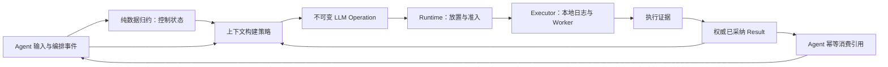

# Agent / Operation 持久化设计

状态：已由 durable-rebuild 总任务完成代码实现与独立验收。authority 格式 2、journal 格式 1；Agent 事件归约、引用上下文、模型/工具统一关联、暂停恢复、引用式 fork 和离线导出已接入。实际 API、预算及验证边界见[存储指南](../../.trellis/spec/backend/database-guidelines.md)、[Agent 契约](../../.trellis/spec/backend/agent-durable.md)与[引用契约](../../.trellis/spec/backend/durable-references.md)。

本设计取代上一版“自足消息检查点为主要恢复依据”的方案。项目处于早期，实现不兼容旧 API、检查点或数据格式；旧 authority 迁移和兼容路径已删除，已有数据库只拒绝、不自动转换或删除。采用历史记录与检查点，沿用 Agent / Operation / Execution / Result，不引入通用 Workflow、Task、Branch、Document 或图执行引擎。

配套：[术语](../../GLOSSARY.md)、[实施验收](./persistence-delivery.md)、[机制研究及证据边界](./research/durable-agent-mechanisms.md)。

## 1. 目标与保证边界

- Agent 保存自身输入、配置与编排关系，通过追加历史重建控制状态。
- LLM 和 Tool 都是 Operation。确定请求归 Operation，业务输出归权威采纳的 Result；Agent 只引用，不另存请求/回复或聊天 transcript。
- 上下文由策略沿引用构建；提交后成为新 LLM Operation 的不可变输入。
- 历史、恢复、导出、fork 和因果图使用同一组事实，不依赖活跃 Agent、远端执行器在线或可丢失展示事件。
- Ecto 权威存储默认 SQLite、可选 PostgreSQL；执行端使用本地 SQLite 证据日志。
- 不承诺共识、自动切主、跨库原子事务、环境迁移、外部副作用 exactly-once、模型确定性重现或撤销现实改变。

一个 authority 数据集只能由一个活动主机拥有。version/generation 防止本地并发与旧实例写入，不是跨分区 fencing。PostgreSQL 可以是权威专属的外置数据库；执行节点不直接访问权威库。磁盘丢失且无备份时，executor 日志不能重建完整 Agent 历史。

## 2. 事实归属：正文只拥有一次

| 事实 | 权威归属 | Agent 保留什么 |
| --- | --- | --- |
| 用户输入、显式继续/风险决定 | Agent 输入或决定事件，正文内联或引用不可变 artifact | 输入身份、内容引用及因果 |
| 默认模型/工具策略、指令、环境与 secret 引用 | 版本化 Agent definition | 配置版本与显式变更记录 |
| LLM 的确定 prompt、工具 schema、有效非敏感模型参数 | Operation 不可变描述或其内容引用 | operation_id、步骤角色、来源与顺序 |
| Tool 确定参数 | Operation 描述 | 调用 ID、operation_id、ordinal、join |
| LLM/Tool 业务输出、usage、可用 provider request ID | Operation 的 accepted Result 或其不可变内容引用 | 消费引用与结果摘要校验值 |
| 启动意图、终止观察、回执 | Executor journal / execution evidence | 不复制；通过 Runtime 核对 |
| 轮次、等待/汇合、停止、结果消费 | Agent 编排事件 | reducer 得到的控制状态 |
| 展示、token 进度、节点报告 | 有界临时投影 | 不作恢复依据 |

Result 仍是值，不新增独立可调度实体。Executor final result 只是执行观察，不能绕过权威采纳成为 Agent 输入。接受 uncertain 后到来的 success 保留为证据；显式决定可以引用它，但不覆盖旧 accepted Result。

Agent 不维护第二份 user/assistant/tool transcript。用户原始输入必须在模型调用前独立保存，不能只藏在后来生成的 prompt 中。内存消息数组可作为可丢弃缓存；检查点和 Agent 事件不得复制 Operation 请求/回复正文。

这里消除的是重复事实源，不承诺所有字节物理只存一次：多个模型请求可能共享文本；executor 日志和权威库可能为断连可靠性各存一份结果。可使用不可变 artifact 共享内容，但不能为节省空间依赖远端 journal 永久在线，也不在本轮引入去重/GC 框架。

## 3. 职责与正交性

- Actions 定义 Operation / Execution / Result / Handler，不依赖存储或 Agent。
- Harness 定义原生模型、Tool、消息契约及提供者实现，不管理持久编排或节点放置。
- Agent 拥有输入、配置、上下文选择、编排、纯 reducer、fork 和继续策略。
- Runtime 拥有 Operation/Execution 状态、目标选择、本地/远端执行、取消、证据核对与 Result 采纳。
- Storage 提供 AgentRecords、OperationRecords、ExecutorJournal 等具体事务入口和严格 codec；不调用模型、Tool、网络或解释 prompt。
- Node 与 Server/Web/CLI 宿主显式接线；加载库不启动 Repo、创建数据集或执行 migration。

Agent 依赖稳定 Operation 身份、accepted Result 和统一不确定性语义，不依赖 Gateway PID、节点发现、报告租期、executor_boot_id 或具体路由。模型/Tool 的能力和环境需求由集成层映射，目标选择归 Runtime。

本地/分布式与内存/durable 是两个维度。内存模式可采用相同编排和上下文模型，但不提供持久恢复保证；durable 模式必须同时满足权威提交和执行端证据协议。本地 durable 工作也走 Gateway，不绕过日志。写库失败不得降级为内存。

正交不意味着无协调：准备 Operation 与推进 Agent 必须有同一个权威提交点；结果接受与 Agent 消费可以是两个独立事务。跨节点、跨数据库和外部副作用之间仍然非原子。

## 4. Agent 历史、归约与上下文

### 4.1 事件契约

事件具有稳定 ID、scope/agent_id、连续的已提交 seq、类型/版本、turn_id、可选 operation_id、因果引用、payload 或内容引用、去重键。事件名称是设计词汇，最终 API/枚举在实现任务中确定。

| 事件示例 | 内容 |
| --- | --- |
| input.accepted | 原始输入或其内容引用、输入身份 |
| model.request_prepared | 模型 operation_id、step、上下文来源与顺序 |
| model.reply_observed | operation_id、已采纳 Result 引用；不复制回复 |
| tool.batch_prepared | 模型来源、调用/Operation 映射、ordinal、汇合规则 |
| operation.result_consumed | operation_id、已采纳结果标识/摘要、消费角色 |
| turn.interrupted / agent.continue_decided | 中断原因、未决引用、显式决定与依据 |
| agent.config_changed / context.selected | 配置版本、固定的来源选择及变换规则 |
| agent.forked / context.inherited | 派生来源、继承引用及风险 |

控制状态 `reduce(state, event)` 是版本化纯函数。它只归约已提交事件；读取引用由有界加载层完成，不在 reducer 中执行 I/O 或副作用。重建不能读取“当前最新配置”改写既有含义。未知版本、事件缺口、内容缺失/摘要不符明确阻塞，不静默跳过。

Agent 的事件 seq 是提交顺序，不预留尚未提交的结果事件位置。并发 Tool 的 ordinal/join 决定业务消费顺序，不代表实际完成顺序；Runtime 的完成顺序独立。多个 Agent 没有全局序号；跨节点时间戳不能推导全序或精确耗时。

### 4.2 上下文是构建产物

`build_context(control, eligible_sources, policy, budget)` 按固定高水位和明确来源读取 Agent 输入、Operation 描述及 accepted Result，产生本次逻辑模型请求。策略可以选择窗口、检索、摘要，但不能将未采纳执行证据当成功结果，或擅自解除未知副作用 blocker。

来源清单包含记录/Operation/结果引用、顺序、选择截止点、策略/指令版本及摘要/截断等变换。清单由新 Operation 的来源元数据拥有；Agent 准备事件只引用 Operation 和必要的编排身份，不再维护第二份清单。跨引用必须同权威可验证。

生成的完整逻辑请求（messages、工具 schema、有效非敏感模型参数）保存到 Operation。只有摘要/哈希不足以还原请求。凭据调用时解析，绝不持久化。逻辑请求不是原始 HTTP 报文；如未来要求报文字节审阅，需要另行约定 adapter 版本和去认证请求体采集，不能虚称现有快照已提供。

已准备的请求不可因历史增加、配置更新或策略变化而重建成不同内容。摘要需要 LLM 时，摘要自身也是 Operation，其 Result 被明确消费后参与新请求；重放不能重新生成摘要。普通消息格式仅在 Harness/adapter 调用边界出现。

### 4.3 检查点

检查点是控制投影的加速缓存：agent_id、through_seq、状态/reducer 版本、投影摘要、continuation、输入/上下文引用、pending Operation、join/order、消费引用、阻塞和来源信息。不保存正文 transcript、活对象或远端进程状态。

支持的事件版本内，完整历史和不可变引用闭包必须足以重新归约状态。缺失或坏检查点可丢弃后从历史有界重建；坏历史/内容不能靠猜测修复。实现需约束分页、批次、内存、取消和总恢复预算，超限可报告待继续加载，不能丢弃前缀。

## 5. 数据布局与身份

优先复用已有八张权威业务表，而不是为图、请求快照、上下文再建并行事实库：

| 表 | 目标职责 |
| --- | --- |
| agents | 身份、definition 版本、generation、lock_version、已提交 history_seq、可选投影/检查点指针 |
| events | Agent 自身输入与编排事件；独立 Operation 的历史可使用其自身 scope |
| checkpoints | 绑定 through_seq 的可丢弃控制投影缓存 |
| operations | 所有 LLM/Tool 的不可变请求及来源、owner/turn/step、accepted Result |
| executions | 稳定 attempt、executor/boot、prepared/send_claimed、预算和观察 |
| execution_evidence | 执行回执、内容/摘要、来源与显式核对信息 |
| commands | scope/command_id、参数摘要与提交响应，保证命令幂等 |
| artifacts | 被输入、Operation、Result 引用的不可变内容及摘要 |

executor 保留 journal_attempts；两类数据集另有 storage_metadata 与迁移版本表。表数不是形式约束，最终 schema 由实现任务证明；不能重复维护 messages 表、event 正文和 Agent transcript。

所有业务身份使用不可复用稳定字符串 ID。PID、monitor、timer、端口、闭包、provider session、活 Ref 和节点本地容量账本不落库。内容遵守字符串键 JSON、版本、深度/大小限制；大内容引用 artifact；摘要验证与引用提交保持同库原子。秘密字段检查不是通用文本秘密扫描器，备份和内容权限仍需保护。

Operation/Result 内容和历史引用默认保留；不能先删除被引用的结果再宣称 Agent 可恢复。首版无自动 GC。未来 GC 需涵盖 fork、导出和请求来源引用，不依赖简单的“Agent 已结束”。

## 6. 事务与执行协议

### 6.1 Agent 接受、准备和消费

1. 输入事务保存原始输入、事件、command 响应及 version/seq；提交后才确认输入并更新内存投影。
2. 上下文构建和纯参数校验可在事务外进行；提交时重新校验 Agent version/generation、来源截止点和引用。
3. 一个权威事务创建完整 LLM Operation/attempt，追加准备事件并推进等待状态。Tool batch 同理，整批 Operation、ordinal/join 和事件原子提交；非法批次零派发。
4. 提交后 Runtime 才可取得派发权。返回已准备身份，禁止 submit 再创建无关 Operation。模型和 Tool 统一拥有 Agent/turn 关联。
5. 消费事务校验 Operation 归属、turn/generation、accepted Result 标识/摘要，追加唯一消费事件并推进状态。不复制 Tool message 或模型回复；上下文从引用投影。

消费去重依据 agent_id + operation_id + consumption_kind，重复命令返回原响应，部分重叠/身份不符拒绝。并发结果分别采纳，不通过预留 Agent 事件槽位解决竞争；消费/汇合以明确事务和版本校验推进。

数据库通知或进程消息只是唤醒。通知丢失时可从已提交记录读取未消费结果；在 Agent 未记录消费前不能自动将其纳入新上下文。展示仅发布提交后的投影，丢失展示不影响事实。

### 6.2 Runtime 与 Executor

- 权威先保存 Operation 和一次 prepared attempt，再 CAS prepared → send_claimed，之后发送一次 admit；不在数据库事务内发送网络消息。
- 执行端验证 authority/operation/attempt/executor/boot 与请求摘要，提交本地 start_intent 后才启动 Worker；重复身份不再启动。
- 完成后本地原子保存终态、附件与稳定 receipt，再上报；保存失败不能宣称 durable completion。
- 权威保存证据，再以 accepted_result 为空和版本条件采纳终态；accepted Result 提交成功后通知 Agent。
- 同一 receipt 的数据重传可以幂等；它不是重新执行 Handler。持久 ACK 证明权威保存了内容，不证明外部进程已停止。
- 重启后的遗留 start_intent 标为 unknown_after_restart，不补跑、不重建原 Worker 或容量占用。

默认每 Operation 最多一次尝试。send_claimed 后崩溃无法证明是否发出；start_intent 无法证明副作用发生与否；not_found 无法证明未执行。LLM 同样有费用和未知窗口，不默认安全重试。显式决定新工作时使用新 Operation，并关联原因/旧身份。

权威必须独立持有 accepted Result 所需内容，不能只保留指向远端 journal 的地址。executor 与权威的可靠性副本允许存在；同一权威内可共享 immutable content。跨库传输不是原子事务。

首个 deadline/cancel 停止原因及实际终止观察分别保留。取消请求、deadline、DOWN、节点断连都不能证明外部副作用不存在；正常返回不能被后来取消改写。未知外部效果默认阻塞下一步，包括阻止模型自动换 ID 请求同类工作；风险接受或证据解决必须显式留痕。

## 7. 恢复与活跃读取

- 热 Agent 的普通观察读取已提交投影；未提交内存事件不能作为 durable 事实。精确审阅指定 generation/through_seq，不承诺跨对象原子实时快照。
- 冷 Agent 可以在 executor 全部离线时只读历史、归约、导出。恢复控制状态与恢复执行是两件事。
- 激活前核对数据集身份、版本、备份标记、内容引用和所有权；以 CAS 增加 generation，串行化本地激活并退役旧发送者。CAS 本身不能收回旧进程已取得的派发权。
- 通过 checkpoint + 后续事件或完整历史归约，恢复为 paused；派发、模型或 Tool 不能由重放触发。
- 对遗留轮次追加幂等中断/核对事件，而不是修改旧事件或伪造失败 Result。只读检查不写修复事件。模型协议需要未知 Tool 观察时，它是有来源的投影，不授权继续副作用。
- Runtime 按稳定身份查询已有证据；已采纳未消费可由显式继续完成消费，确认未 claim 的 prepared 可首次派发；已 claim 未决保持 blocked/uncertain，不自动重新 admit。
- 恢复未发出工作所需的 provider/profile、指令版本、环境和 secret 引用；依赖缺失或版本改变必须阻塞或显式重绑定。缺少执行依赖不应妨碍只读历史。预设名称相同不证明配置相同。

## 8. Fork、历史、导出与图

Fork 仍从安全控制位置创建独立新 Agent，不创建 Branch，不重执行历史。继承的是明确选择的输入/Operation/accepted Result 内容引用和配置，不复制 prompt/transcript 正文到新 Agent，不把源 Operation 改成新 Agent 所执行。

首版同权威 fork 物化继承清单和 provenance，直接引用同库不可变内容闭包；新 Agent 不需要递归读取父 Agent 的事件前缀或启动父进程。源事实保留，引用必须在事务中验证。独立指编排/生命周期独立，不承诺删除源内容后仍能恢复；删除/跨库搬迁需要未来明确的引用保留或内容复制协议。

安全边界要求无待消费或未决工作，完整调用配对；冻结源发送者不等于远端已停。原 Agent 在所选位置之后仍可能改变共享环境，默认阻止新 Agent 执行，直到确认或显式接受风险。新 Agent paused/await_input，新的工作使用新身份，不继承 pending、消费去重、命令、取消状态或 provider session。继承输出不计为新执行或新费用。

历史和导出固定高水位，keyset 分页并遍历所需引用闭包，区分 performed/inherited。完整导出包含输入、Operation/Result、事件、配置、artifacts 和摘要；脱敏/缺失引用必须标注，不能再承诺完整恢复。只读导出不授予执行权限，不采集模型私有思维链。

执行因果图与上下文来源图是同一事实的投影。边区分触发、请求来源、执行、采纳、消费、汇合和继承；并行节点保持偏序，unknown 不能画成失败或已停。图不拥有第二份可修改业务状态，也不作为新的执行 DSL。

## 9. 存储、错误与运维约束

- SQLite 使用本机持久卷、WAL、synchronous=FULL、FK ON、短 immediate 写事务、有界连接/锁等待；不能用网络文件系统 WAL。Exqlite busy handler 与 PRAGMA busy_timeout 回读不同，按当前[存储指南](../../.trellis/spec/backend/database-guidelines.md)核查真实争锁。
- PostgreSQL 使用同步持久提交、有限连接池、CAS 与唯一约束；不依赖某一 adapter 的 RETURNING、advisory lock 或通知保证业务正确性。
- 数据集显式 initialize/migrate，boot/open 不创建或修复；拒绝身份/角色不符、新格式或 restored_backup。备份恢复后暂停核对，不能把丢失派发记录当未派发。
- 存储事务禁止网络/Handler/文件副作用，失败无部分业务提交；不自动重试写事务或外部工作。提交结果未知通过稳定 command/Operation 身份重新读取。
- 明确区分 invalid_data/conflict、stale_generation、schema_unsupported、artifact_missing、storage_unavailable、storage_outcome_unknown、dependency_missing 和 unresolved_execution；错误不泄露 SQL 或秘密。
- Node/Repo 注册 ready 不等于 durable 准入；真实提交失败关闭相应准入，不能降级。无法写库仍尽力停止工作，不等待写库制造停止保证。
- SQLite 使用一致性备份而非复制单个活跃 db 文件；PostgreSQL 使用一致性备份。未确认回执与 attempt 去重身份不得静默清理，配额满停止新准入。
- 保留当前协议的完整 envelope 大小限制，不以 artifact 绕过 Operation/Result wire cap；编码格式、分页、恢复/构建/事务字节、队列及超时均需有界并在实现任务验证。

## 10. 故障与验收不变量

| 切点 | 必须成立 |
| --- | --- |
| 输入提交前/后响应丢失 | 未提交不确认；已提交按 command 重读，不重复工作 |
| 请求构建后、准备提交前 | 没有可执行 Operation，不派发 |
| 准备事务后 | Agent 等待身份与 Operation 同时存在 |
| claim 前 / 后 | 前者显式继续可首次派发；后者不自动重发 |
| start_intent 后、外部改变后终态前 | 保留未知，不补跑、不伪造失败 |
| receipt 后、权威 accept 前 | 重传/查询证据，不能当 Agent 已采纳 |
| accept 后、消费前 | 恢复消费一次，不再次执行 |
| 消费后、下一步前 | reducer 重建相同控制位置，不重复引用 |
| checkpoint 丢失 | 从受支持事件与内容重建；零副作用 |
| 历史/内容损坏 | 明确阻塞，不拼接猜测内容 |
| 恢复期间旧实例/迟到证据 | 旧写拒绝，原/新轮次和 fork 不被错误推进 |
| 模型配置/策略更新 | 已准备请求保持原样，新请求明确记录新版本 |

上述不变量已通过新的双库事务、重放/缓存等价、命令/消费幂等、反序结果、进程/VM 重启及断连调用计数测试取得证据，详见[交付验收记录](./persistence-delivery.md)。同主机 peer 与独立进程证据不代表物理主机、断电或付费提供者验收。

## 11. 取舍与后续工作

选择 Agent 事件归约而不是消息快照主导，增加有限的事件版本维护成本，换取单一事实来源与上下文自由构建。旧事件读取使用明确版本分支，不建立通用 upcaster/确定性 workflow replay 框架。检查点只加速归约，Operation 状态仍由 Runtime 事务维护，不要求整个系统全面 event sourcing。

Ecto.Multi 仍是本地提交屏障；不照搬 JSONL SessionHandle/flush。借鉴 DeepSeek-Harness 的事件优先、先记后做和显式中断，但其信息来自用户提供的总结，未核验源码或故障保证。外部系统不能替代 Beamlet 的双库和分布式证据。

实际 API、schema、事件枚举和预算已在实现任务中收敛，见[交付验收](./persistence-delivery.md)与各应用 README。普通上下文策略已实现；检索/摘要策略、自动 GC、跨权威内容迁移及图 UI 仍是未来独立需求。新格式初始化保持显式运维操作。
