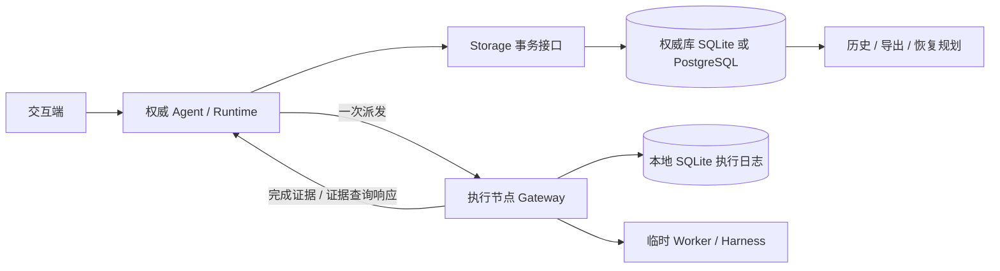

# Agent / Operation 持久化设计提案

状态：核心方向及两原语简化已获用户同意：历史记录 + 检查点；fork 从安全检查点复制有效上下文并创建新 Agent，不设独立 branches 模型。仅设计，尚未实现。

本提案承接 [10-15 分布式架构归档](../../.trellis/tasks/archive/2026-10/10-15-distributed-agent-architecture/design.md) 中延期的持久化与恢复议题。它扩展而不改变 Operation / Execution / Result 的区分、显式权威、Harness 独立性、单次执行和不确定时不自动重试的原则。当前代码仍为内存实现；不得将这里的表、接口或保证解读为现有能力。

配套材料：[术语](../../GLOSSARY.md)、[实施与验收计划](./persistence-delivery.md)、[外部机制调研与简化决策](./research/durable-agent-mechanisms.md)。

## 1. 目标与保证边界

需要支持：

1. Agent 及其 Operation 的持久身份、已接受输入、完整业务历史和有效上下文。
2. 权威进程或同一权威节点重启后恢复；显式继续未完成轮次。
3. 无须启动 Agent 即可审阅历史、检查执行证据、导出轨迹。
4. 回到安全检查点创建独立的新 Agent，复制有效上下文后继续推理；原 Agent 的历史始终可审阅。
5. 使用 Ecto；权威库默认 SQLite，可选 PostgreSQL；执行节点的本地日志默认 SQLite。
6. 持久数据全部是可版本化的数据，禁止 PID、reference、闭包、端口、进程字典、任意 struct 和客户端对象。

不承诺：分布式共识、自动故障转移、数据库跨节点复制、跨库原子事务、外部副作用 exactly-once、环境迁移、模型逐 token 的确定性重现、撤销文件/数据库/API 等外部真实改变。

单个逻辑权威及其数据库是唯一业务事实源。PostgreSQL 可以是权威专属的数据库服务；“存储在权威节点”指权威拥有并独占写入该数据集，执行节点不直接访问它。SQLite 则使用权威本机持久卷。若要求 PostgreSQL 物理同机，部署为本机实例即可。

部署必须保证同一个 `authority_id` 同时只有一个活动主机写入，禁止同时启动原节点和数据库副本。库内版本检查用于本地并发与旧进程隔离，不是跨分区 fencing 或自动接管协议。失去磁盘或数据库且无可用备份时，不能凭执行节点日志重建全部 Agent 历史。

## 2. 已核对的现状与必要变化

| 当前实现 | 本提案要求 |
| --- | --- |
| Agent.Server 的 messages、turn、pending、results 等在内存中 | 显式领域记录、检查点、输入与结果消费记录 |
| Agent.Ref 含 PID 和 VM 内 reference；Discovery 只列活跃实例 | 新增持久 ID；活跃 Ref 仍只定位一个进程实例；历史查询独立于 Discovery |
| Runtime 的 Operation ID 为数据；Execution 还含 endpoint PID、incarnation、handle | 保留业务 ID，新增持久 attempt ID、executor ID、运行代次；句柄绝不落库 |
| Coordinator 在内存中接受一次终态，保留期后消失 | 一次终态接受改由数据库条件更新与唯一约束保证 |
| Operation.credentials、ModelBinding.credentials 为显式临时输入 | 可恢复定义必须使用 secret/profile 引用，凭据仅在调用时解析 |
| Gateway 的 admission、tombstone、worker 账本均不持久 | 执行前本地落盘；重启后能回答既有 attempt 的证据查询 |
| Agent Display 是有界 live-context 投影，允许截断、省略，注解使用运行态 reference | 只从完整业务数据写历史/检查点；恢复后重建展示，不保存投影或其身份 |
| Node/Runtime observations 是非原子的建议性观察；Node services ready 仅表示本地注册存在 | 保留现有观察语义；持久准入另受数据库提交与日志可用性约束 |
| Gateway 按首个停止触发原因分类已观察的 worker 停止；Coordinator 保留执行来源终态 | 执行日志与证据保留停止原因及观察结果，不用取消请求重写 deadline/success |
| Agent/provider/gateway 失效后不重放业务 | 维持该原则；恢复基础设施和状态不等于重执行 handler |

兼容性核对基线为 `a078aa3`，覆盖 `e9bd6b4`（停止原因）、`8eb3683`（Runtime observation）、`0a1b1de`（Agent display）及 `0c316bc`（Node observation）。这些变化未改变业务状态归属，也未新增 durable 能力；两个新增原语及现有表数保持不变。

证据文件：`apps/beamlet_agent/lib/beamlet/agent/server.ex`、`model_binding.ex`、`ref.ex`、`display.ex`，`apps/beamlet_runtime/lib/beamlet/runtime/operation_coordinator.ex`、`executor_gateway.ex`，`apps/beamlet_node/lib/beamlet/node.ex`、`observation.ex`，以及 [当前存储指南](../../.trellis/spec/backend/database-guidelines.md)、[Runtime 契约](../../.trellis/spec/backend/operation-runtime.md)。

当前 `turn`、peer request、delegation group 等使用 `make_ref()` 的关联，必须获得独立的持久字符串 ID，不能对 reference 编码后保存。已有进程无法事后承诺历史完整；切换前启动的 Agent 只能保持临时模式，或在显式静止点导入上下文并标记 `history_complete=false`。

## 3. 架构选择：事务状态与追加历史

采用“规范化当前状态 + 不可变业务事件 + 可恢复检查点”。不把完整 GenServer state 序列化，也不要求通过从头重放事件运行整个业务系统。

- 当前状态负责查询、约束和决策，事件负责审阅、追因和导出。
- 每次领域转换在一个权威数据库事务中同时写状态、事件和必要检查点。提交前不得对外声称成功。
- 检查点携带有效上下文和明确的继续位置；加载时只核对其引用和已有 Operation 状态，任何纯数据转换都不能调用模型、Tool 或网络。
- 所有会影响恢复的事实必须可靠落盘。流式 token、临时展示进度允许有界抽样或丢弃，最终模型回复和完整合法 Tool 参数必须保存。
- 每次改变 Agent 可恢复位置时，同事务保存一个完整的检查点描述；完整指逻辑自足，可以引用不可变 message/artifact，而不必复制全部消息内容。Operation 的观察变化保存在其当前记录和事件中，结果消费时再推进 Agent 检查点。
- 恢复直接读取检查点及其引用的 Operation/证据，不要求从头重放事件。首版检查点或引用损坏则明确阻塞；从旧检查点重建属于可选修复工具，不是运行时的另一条恢复路径。

这比只存快照多了审计能力，又避免全面 event sourcing 的事件归约器、重放与代码版本约束。需要兼容的是检查点与历史数据格式，不是旧 handler 的执行环境。



### 3.1 应用职责及依赖

建议新增一个 `beamlet_storage` 应用，集中 Ecto Repo、schemas、迁移、严格 JSON codec 与具体存储函数。它不启动 Agent、不派发 Operation、不依赖 Runtime / Agent / Harness / Phoenix。不另外建立通用 Storage behaviour、Document 系统或事务 bundle DSL。

```text
beamlet_actions -> []
beamlet_storage -> [Ecto, ecto_sql, ecto_sqlite3, postgrex]
beamlet_runtime -> [beamlet_actions, beamlet_storage]
beamlet_harness -> []
beamlet_agent -> [beamlet_actions, beamlet_runtime, beamlet_harness, beamlet_storage]
beamlet_node -> [上述组合所需应用]
beamlet_web / beamlet_cli -> [Agent 公共命令与历史接口]
```

Runtime 拥有 Operation/Execution 转换规则和本地证据协议，Agent 拥有上下文、fork、委派与恢复策略。Storage 内部分为 AgentRecords、OperationRecords、ExecutorJournal 三组具体函数；调用方传入已验证的数据与版本，内部使用现成的 Ecto.Multi 完成必要的跨表事务。它们不是三个可插拔框架，不提供任意 SQL/Repo 给 UI，也不解释 Tool 或模型语义。Agent 与 Runtime 使用同一个权威 Repo，结果接受和消费仍可分成两个各自原子的事务。

### 3.2 原语预算

新增的 durable 原语只有两项：**历史记录、检查点**。Agent、Operation、Execution 与 Result 沿用原架构；执行证据是带身份的记录值。fork/回撤是从检查点创建新 Agent 的操作，不是独立实体。secret ref、command_id、代次和继续位置均为已有对象的字段，不是新的可调度实体。

不增加独立 Branch 实体、父前缀递归解析、Task/Workflow、Effect、通用 Document、replay-safe 分类、独立 stream、inbox/outbox、lease、通用调度器或恢复引擎。恢复是现有 Agent 状态机的加载路径；证据核对是 Runtime 的查询路径；导出是历史记录的序列化。物理表与私有辅助函数不等于公共原语，增加它们仍须说明具体用途。

SQLite 与 PostgreSQL 是同一 SQL 实现上的两种 Ecto adapter，不另建两套领域 backend。显式定义 SQLiteAuthorityRepo / PostgresAuthorityRepo（adapter 在编译时确定），由组合层在启动时选择一个；ExecutorJournalRepo 独立。库的加载不自动启动 Repo、创建文件或执行 migration。临时模式继续可用，但持久 Agent 必须运行在持久 Runtime 上；不得在写库失败时偷偷降级到内存。

### 3.3 Live display / observation 不进入恢复事实源

`Agent.Display` 只展示 `live_context` 的有界替换式投影，不是 transcript，也不能作为模型输入。entries、activities、字段内容以及整个 display 都可能因预算省略；缺失 display 不能理解为保留上次快照。活动 `pending` 只说明取得 Runtime Ref，不证明 executor 已接纳或启动；placement 未被实际观察时仍为 unknown。

因此不订阅 display/snapshot 再落库，不把 `display_entries`、activities、subscriber credits 或注解 reference 放进检查点。历史、恢复、导出与 fork 使用完整规范化业务数据；恢复/fork 后为展示重新生成注解和运行身份。可选 `display_metadata` 的公开 title/preset/option 标签若需保存，须转成受严格 codec 校验的字符串键数据；这些标签不是配置、授权或 secret 保护，不能替代实际模型/Tool/环境定义及其引用。

Node/Runtime observation 同样只用于当前观察：报告可能过期、不可达或不完整，可用容量不是资源预约；它们不能证明旧执行未发生或已停止，不能授权恢复重发。保持现有非原子、有界只读语义，不增加 observation 历史表或恢复调度器。持久准入与运行注册状态的区分见第 11 节。

## 4. 数据契约与身份

### 4.1 持久身份和运行身份分离

- `authority_id`：安装/数据集的稳定 UUID；BEAM node name 只是可变化的路由配置。
- `agent_id`：不可复用的 UUID；现有可读 id 保留为 authority 内的别名。删除后旧记录不得误指同名新 Agent。
- `turn_id`、`operation_id`、`attempt_id`、`command_id`、`checkpoint_id`、`message_id`：不透明 UUID。Operation ID 继续使用不可复用随机 ID 即可，不要求改名其领域概念。
- `executor_id`：执行节点磁盘数据集稳定 ID；`executor_boot_id` 每次 Gateway 运行生成，编码为字符串。
- `agent_generation`：同一 Agent 每次激活/冻结后的本地写入代次，结合 `expected_version` 拒绝旧实例写入。
- PID、monitor、timer、当前 endpoint、资源槽占用、subscriber credits、活跃 Ref：只在内存重新建立。

调用方可保存持久 locator，但须通过显式 `restore` / `lookup` 获取新的活跃 Ref。旧 Ref 永远不会自动指向新进程。将 node name 从磁盘读为字符串后只通过受信任部署映射解析，禁止 `String.to_atom`。

### 4.2 可持久化数据

独立的严格 codec 接受字符串键的 JSON 数据、有限数值、布尔、null、数组；校验 UTF-8、深度、总字节和 schema version。二进制大对象进入 artifact；枚举保存约定字符串。禁止通过 Erlang external term、`inspect`、`term_to_binary` 或任意 struct dump 绕过约束。

Operation 的持久描述包含 kind、protocol version、业务 payload、能力/环境引用、claims、预算和安全 metadata；不含 credentials、handler MFA、settings 里的活对象。原始执行参数不可静默截断。若其内容无法在策略允许下持久保存，则拒绝持久提交，不能仅存 hash 后声称可恢复。

Agent 定义保存 provider/profile ID、版本化非秘密配置、catalogue/tool schema 快照及 digest、context policy/version、environment ref、secret ref。恢复时重新解析本地受信任注册表和凭据；缺少依赖或 schema 不兼容进入 `blocked`。配置变化不可静默改变未完成工作的语义；必须经显式重绑定命令记录差异。secret ref 不含密钥值，凭据轮换不保证重现原模型结果。

上下文需要保留实际发给模型的规范化 messages、Tool schema、策略输出及其 digest；保存规范化模型完整回复和用量/可用 provider request ID。私有思维链不作为所需轨迹；仅保存系统本来可观察的数据。通用数据校验无法识别嵌在文本中的所有秘密：持久模式必须使用明确内容策略，保护数据库/备份，并由提供者避免把凭据写入输出。

## 5. 最小数据模型

以下为首版八张权威表的职责草案，不要求为了每个领域名词建立表。Result 仍是共享值，turn/message/关系保存在历史中，继续位置保存在检查点中。不设 branches 表，Agent 直接拥有 head checkpoint。

| 表 | 核心内容及约束 |
| --- | --- |
| `agents` | 稳定 ID、authority_id、alias、定义、head_checkpoint_id、generation、lock_version、history_seq；可空 forked_from_agent_id/forked_from_checkpoint_id 只记录来源；authority+alias 唯一 |
| `checkpoints` | agent/turn ID、消息引用、pending Operation/有序 join/消费集合、继续位置、数据版本、digest、safe_to_fork；不可变 |
| `events` | scope_id、seq、type/version、turn/operation/因果 ID、payload、可空 dedupe_key、recorded_at；继承消息可含 source_agent_id/source_event_id；唯一(scope_id, seq)及(scope_id, dedupe_key) |
| `operations` | immutable description、可空 owner agent/turn、tool_call_id/ordinal、accepted_result、版本；独立 Operation 另有 history_seq |
| `executions` | attempt_id、operation_id、目标 executor/boot ID、prepared/send_claimed、观察状态、预算；已取得的停止原因及终止观察由证据/事件留痕；operation_id 唯一，最多一次尝试 |
| `execution_evidence` | receipt 身份、digest、内容和解决决定；来源+evidence_id 唯一，明确区别于 accepted_result |
| `commands` | scope、command_id、请求 digest、可重读响应；同 ID 同参数幂等，不同参数冲突 |
| `artifacts` | 内容/digest/media type/size；与引用同库提交；初版不自动 GC |

`authority_id` 保存在数据库安装元数据中，不需要 authority 领域实体。首版每个数据库另有一张**非业务的单例安装元数据表** `storage_metadata`（`id=1`、不可变 `dataset_id`、`role`、`format_version`、`restored_backup`），只用于安装身份、格式版本和恢复标记，不建身份/控制框架，也不把元数据塞进 Ecto 的 `schema_migrations`。因此物理表数是：权威 8 张业务表 + 1 张安装元数据表，executor 1 张 attempt 日志表 + 1 张安装元数据表，另加各自 Ecto 自有的迁移版本表。打开已有数据集时，元数据缺失、身份/role 不符、格式较新或 `restored_backup=true` 一律 fail closed；恢复标记是运维核查开关，不是自动备份回退检测，也不能被自动清除。Agent 的 history_seq 或独立 Operation 的 history_seq 通过同事务 CAS 分配历史序号，不设 streams 表。Agent 所属 Operation 共用 Agent 的历史顺序；多个 Agent 没有全局顺序。事件包含完整业务内容，message 是其中具有角色/内容的记录；轮次列表按 turn_id 建索引查询。委派/peer 关系也使用带双方稳定身份的事件，未决集合保存在检查点中。

结果消费的去重键为 `agent_id + operation_id + consumption_kind`，由 events 唯一约束和检查点 CAS 一起保证。除有去重需求的转换外，dedupe_key 为空；两库均须验证该唯一约束行为。每个 Agent 只允许一个活动轮次，通过 Agent 版本更新实现。

事件覆盖输入、实际模型请求/完整回复、Tool 请求/结果、派发与执行观察、终态接受/消费、暂停/恢复/回撤决定及委派观察。可丢失 progress 不是必需恢复事实。统计/轮次/消息列表先用这些记录查询；测量证明确有必要时再加投影，不能同时维护第二份权威 transcript。

执行节点首版仅需 `journal_attempts`：以 authority_id+attempt_id 唯一，保存 operation ID、描述 digest、executor/boot ID、start_intent/terminal/unknown、已记录的首个停止触发原因（deadline/cancelled，可空）、终止观察、终态值和稳定 receipt_id、权威持久接收确认。终态重复上报用相同 receipt_id；不建立通用证据流或独立队列。日志不能修改权威 Result 或上下文。

## 6. 事务与提交顺序

持久写入接在业务转换处，而非 `publish`、`publish_activity` 或观察订阅处。当前 `Agent.Server.complete/3`、`complete_tool/3`、`batch/2` 负责模型回复、结果汇合及批次推进；durable 接入须在对应状态转换中组织事务。Coordinator 的 `accept/2` 必须提交终态后再通知 sink；Gateway 必须在启动 worker 前和上报终态前分别完成本地提交。展示发布只读取提交后的业务状态，可合并或丢弃，不参与恢复正确性，也不替代输入确认或 durable Result 通知。

### 6.1 输入及 Tool 批次

输入接受事务同时写 command 去重、输入 message、turn、事件和继续位置。仅在提交后返回“已接受”。响应丢失时调用方以同 command_id 查询/重试，仅重读既有提交，不再次调用模型。

模型完整回复必须先落盘，再完整验证整个 Tool 批次；任何一个 Tool 参数不合法均为零派发。合法批次在一次事务中创建全部 Operation 和 tool ordinal/join manifest，然后才允许各自派发。先存模型回复可以在崩溃后重新做纯验证，但不能重新请求模型来获取这份回复。

### 6.2 权威派发

1. 将 Operation、attempt、目标及 Execution 的派发状态在权威库提交为 `prepared`。没有可选目标可提交 coordinator-origin `no_target`，无 Execution。
2. 协调器以 CAS 将 Execution 从 `prepared` 改为 `send_claimed`，提交后才发送一次 admit。不得在数据库事务内发消息或调用外部系统。
3. admit 带稳定 authority/operation/attempt ID、目标 boot 关联及描述 digest。凭据在发送前临时解析，不写 Execution 记录。
4. `send_claimed` 后崩溃，无法证明发送与否；恢复只查询该 attempt，不能自动重发。`prepared` 尚未 claim 表示尚未发送，恢复后可由显式 continue 继续该步骤。
5. admission 观察、取消请求、接受终态均在权威库提交，再通知 Agent/UI。

数据库事务和网络发送之间的缝隙无法消除。这里主动选择可能暂停一项尚未执行的工作，避免自动重发一项可能已产生副作用的工作。Execution 上的派发状态只解决“提交前不能发送”和可审阅性，不是独立 outbox，不提供 exactly-once。

### 6.3 执行节点：本地日志是持久模式的默认要求

权威库只能证明自己保存过什么，无法保留执行节点完成但尚未上报的结果，因此持久执行模式默认要求本地 SQLite 日志。单机组合角色也走相同协议、独立日志接口；不增加绕过路径。

1. Gateway 在本地串行准入中验证，暂占内存容量，落盘 admission 和 `start_intent`；写失败则释放容量并明确拒绝，零 handler 调用。
2. 提交 `start_intent` 后才启动 worker。worker 不承担“启动前第一笔写库”的责任。
3. 同 attempt 重复消息只返回既有证据，不启动第二个 worker。状态只到 admission/start_intent 的旧记录也不允许重启后补跑。
4. worker 返回规范化 Result 后，Gateway 将终态值/输出 artifact 与 receipt 原子落盘，之后才上报。大输出以现有 `journal_attempts` 上的版本化 JSON 附件字段内联保存（稳定 artifact ID → digest/类型/原始大小/规范 base64），不另建日志 artifact 表或自有二进制格式：单附件与每 attempt 附件解码后合计各限 16 MiB，编码字段限 24 MiB，同事务逻辑总量限 32 MiB，base64 规范性与 digest/大小须在解码后校验，超限或不完整即拒绝，绝不静默截断。若写入失败，不能上报为 durable completion；保留有界内存重试写入并撤下持久就绪能力，进程丢失后保持 unknown。
5. 权威收到 receipt 后先持久化 evidence，再按终态接受规则处理；持久 ACK 只证明证据已存入权威库。执行节点可重传 receipt，这是数据传输重试，不是 handler 重执行。
6. Gateway/VM 重启后原活跃 start_intent 记录变为 `unknown_after_restart`；不重建 worker、不按历史占用恢复容量。只有当前 worker 实际占用本机槽位。

权威收到的证据必须匹配保存的 authority/operation/attempt/executor ID 与描述 digest，经可信 executor 路由验证；损坏、冲突或身份不匹配的 receipt 不可参与自动接受，留下安全错误和有界诊断。恢复时重新发现的 endpoint 只能承载稳定身份的查询，不代表旧 worker 仍存在。

从真实外部改变到本地终态提交之间仍可能崩溃。即使有本地日志，也不能从 start_intent 推断“未执行”，不能承诺副作用和日志原子性。`not_found` 仅是该日志的数据观察，尤其磁盘丢失/备份回退时不能作为安全重试证明。

停止原因沿用当前 Gateway 契约：第一个由 Gateway 处理的 deadline/cancel 触发原因拥有停止 provenance；后续触发不覆盖它。只有观察到与本次停止请求相符的 worker 终止，才能形成 execution-origin 的 `deadline/worker_stopped` 或 `cancelled/worker_stopped`。无关崩溃仍为 `error/worker_lost`，竞态中的正常返回仍可为 success，不能因为已经请求停止就改写结果。规范化终态连同已观察的停止原因、终止事实与 receipt 同事务保存；已记录的停止观察也保留在日志中。日志写失败或终态保存前崩溃仍按 unknown 处理，不能由请求记录推断“已经停下”，也不能为等待写库而取消尽力停止措施。

### 6.4 终态接受与消费

权威事务以 `accepted_result IS NULL`、expected_version、当前写入代次作为条件更新 Operation，并写 `result.accepted` 事件。影响行数为零时重读既有值；同证据幂等返回，冲突证据留审阅记录，不能覆盖已接受终态。

若先接受了 uncertain/deadline，而后得到真实 success，保留原 Result；新增 evidence/resolution。用户可以显式采纳该证据推进仍暂停的上下文，记录决定与来源；历史上当时接受的 Result 不变。已经停止的轮次或 fork 的源 Agent 绝不因迟到证据自行继续，源 Agent 的证据也不能推进新 Agent。

当前内存实现会将 Tool 的不同 Result 状态编码成观察，再交给模型继续；持久接入不能无条件复用这一推进路径。Coordinator-origin 的 `deadline/termination_unconfirmed` 和 `uncertain/cancel_unconfirmed` 不是 executor 已停证明，与 execution-origin 的已观察停止须明确区分。

持久模式默认将涉及外部效果的 uncertain、未确认停止或日志缺失设为轮次 blocker，不把它伪装成普通 Tool failure 交给模型自动再做一次。用户可显式选择采纳已核实证据、放弃该步并保存中断观察，或承担风险发起关联的新 Operation。若 uncertain 尚未消费，resolution 决定最终进入上下文的观察；若已经显式消费过中断观察，后续证据只能作为新的带来源纠正消息加入，不能覆盖旧 message 或重复占用原 Tool result 槽位。

Agent 消费 Result 的事务同时保存 Tool message、consumed 标记、join 顺序和检查点/下一继续位置。唯一(agent_id, operation_id, consumption_kind) 防止重复进入上下文。消费时必须校验 Operation 的 owner Agent/turn，源 Agent 的 Operation 不可作为新 Agent 的待消费工作；fork 复制的旧返回值是继承消息，不再次触发消费转换。保存 Result 后 Agent 崩溃，恢复只完成尚未消费的数据转换。并发 Tool 结果按原 ordinal 构造上下文，不按到达顺序。

取消首先保存 request，冻结该轮次后续派发，再发尽力停止消息。取消请求不是 worker 已停、也不是撤销外部改变。即使取消成功，已接受的成功结果仍保持成功。

## 7. 恢复模型与继续位置

区分三个动作：`inspect` 只读恢复计划，`restore` 建立新的暂停实例，`continue` 显式推进。启动角色树仅恢复 Repo、发现与查询能力；默认不批量启动所有历史 Agent，不自动调用 handler。

### 7.1 恢复流程

1. 核对 authority_id、schema、备份恢复标记和独占部署；数据库不可用则禁止相应持久输入/派发准入，不以 Node services 的注册 ready 代替此判断。
2. 读取当前 head checkpoint，验证其数据版本、消息/artifact 引用，并核对其中 pending/consumed 集合与权威 Operation/证据。无需重放历史事件。
3. 返回普通恢复说明数据（RecoveryPlan），列明 pending Operation、终态未消费、未决派发、缺少 secret/profile/environment、子 Agent/peer 不可达等事项。它不是持久实体或独立执行计划 DSL。
4. 激活时在权威事务内增加 generation，保存恢复事件；本地恢复控制器串行化同 Agent 激活，以 Registry/监视确认旧本地进程已经退出，再建立新暂停实例。仅 CAS 不能阻止旧进程在提交之后发送消息。
5. 对未决 attempt 可自动做只读证据查询；查询使用 executor_id/attempt_id，不重新 admit，不恢复原 PID。目标不可达保持 blocked/uncertain。
6. `continue(expected_version, decisions, command_id)` 检查 Agent/相关 Operation 版本、配置兼容与 pending 风险；提交决定后推进明确的继续位置。冲突返回新的恢复说明，不隐式采纳用户未见的新证据。

恢复并非强制重新生成所有消息；有效历史和上下文已经在权威库中。必须维护以下可版本化继续位置：

| 位置 | 恢复动作 |
| --- | --- |
| `await_input` | 暂停实例等待新输入 |
| `model_prepared` / `tool_batch_prepared` | 显式继续后可 claim 尚未发送的派发 |
| `await_model_result` / `await_tool_results` | 查询证据/等待，绝不重新发送已 claim 的 attempt |
| `reply_recorded` / `results_to_consume` | 仅做纯数据验证/上下文转换，按消费键幂等 |
| `ready_for_next_step` | 显式继续后创建下一项新 Operation |
| `await_delegation` / `await_peer` | 查询远端历史或等待显式解决；不重建子 Agent、不重发消息 |
| `interrupted` / `blocked` / `completed` | 不自动推进；展示原因和允许的显式动作 |

最终模型回复的消费可以触发下一轮 Tool，但只有持久化的完整参数经全批验证后才能如此做。已有 Operation Result 与未生成的新 Operation 之间必须由继续位置区别，避免“恢复消息”变成重执行。

### 7.2 预算、环境、委派与重试

运行中的 budget 使用本 VM 单调时钟，永不持久化绝对 monotonic timestamp。保存原预算、已观察 elapsed 和 UTC 审计时间；停机后不尝试恢复原 timer。已 claim 的工作默认按 interrupted/uncertain 处理；需要新工作时显式给新 Operation 新预算，并记录 predecessor。跨机 UTC 不用于证明 worker 已停。

环境引用不是环境快照。Shell session/provider instance 不能重新绑定到同路径的新环境；恢复必须由 provider 校验稳定环境身份/版本，可选返回 `unavailable` / `changed`。环境缺失不会触发其他节点或沙箱回退。

父子 Agent 可能在不同权威库中，关系事件仅记录本方观察和因果关联。父 Agent 恢复不会启动/继续/关闭远端历史子 Agent；逐个显式恢复。peer 消息首版不提供可靠投递和自动重发；未完成请求恢复为 interrupted，显式新请求使用新 message_id。不得重建过期 TTL 或复活旧收件箱。

同一 Operation 首版仍最多一个 attempt。人工决定重试时创建新 Operation（`retry_of` 关联和明确风险接受事件），不改原 Operation、不给原 attempt 第二次机会。provider 的无副作用读取/receipt 传输重试与业务 handler 重执行必须分开。

## 8. 历史审阅与轨迹导出

历史查询以持久 locator、turn、operation、事件 cursor 为入口，不依赖活跃 Agent/Coordinator，也不返回活跃 PID。至少支持：轮次列表、有效上下文、fork 来源、每步模型输入输出、Tool 请求与结果、执行证据、取消/不确定性、恢复/重绑定/回撤决定、委派因果关系。

区分三种视图：某时刻保存的事实、某 Agent 的有效上下文、当前运行观察。提供 `as_of_seq`、继承消息来源和 artifact 完整性状态，避免把源 Agent 的迟到结果显示为新 Agent 的当前上下文。

默认导出格式为版本化 manifest + JSONL events + checkpoints + artifacts。Operation 的历史描述、执行证据与终态来自指定高水位内的不可变事件；messages 是 events 的消息视图，不再导出一套独立权威记录。manifest 包含 export version、authority/Agent IDs、fork 来源、范围、各 scope 的固定高水位、内容 digest、缺失项、脱敏策略及 `history_complete`。每条事件有 scope/seq、causation ID 和原始 recorded_at；不伪造跨 Agent 全局顺序。

大数据先固定高水位，再用短事务 keyset 分页读取不可变记录；不能混入当前可变状态。首版不自动删除历史/artifact，因此无需导出 pin、租期、GC 协调或导出调度服务；显式删除数据集须由运维在停止导出后执行。未来确需在线删除再设计保留协调。避免长事务拖住 SQLite WAL checkpoint。

默认导出只含所选 Agent 及其已经复制的初始上下文；不追溯加载祖先来拼接历史。原 Agent 的完整审计事实不随 fork 复制，来源仅为 provenance：新 Agent 的上下文/恢复可自足，但不能声称包含来源路径的完整执行轨迹。跨 Agent/权威的原始执行或委派轨迹以 external reference/未包含状态表示，另行显式查询。导出不执行代码，不自动包含 executor 整库或 secret refs 的解析值。导入（将包变成可执行 Agent）延期；读取/验证导出包不等于导入授权。

轨迹反映已观察行为与规范化输入输出，可重建上下文，但不能保证重新调用模型得到相同内容。脱敏导出允许丢失内容并标记，不再承诺可恢复。

### 8.1 轨迹的具体用途

| 用途 | 必需事实 | 首版处理 |
| --- | --- | --- |
| 恢复与继续 | checkpoint、请求身份、已接受结果及消费状态 | 核心能力；不依赖可丢失 span/token |
| 故障复盘与审阅 | 实际模型输入输出、Tool 参数/结果、因果、执行证据和用户决定 | 核心查询；区分当时事实与后来证据 |
| 回撤与方案比较 | 复制的上下文、来源检查点、配置版本 | 保留原 Agent；比较两条独立路径 |
| 成本与性能分析 | provider/model、usage、已知费用、各节点本地 duration | 查询/导出字段；费用未知标 null，跨机时钟不直接相减 |
| 评测与回归样本 | 输入、实际配置、预期结果/人工标签、Tool 轨迹 | 允许离线导出，执行评测需独立 fake/sandbox，不重放真实副作用 |
| 上下文策略改进 | 原 messages、实际发送的 context manifest、压缩/重置来源 | 可检验遗漏与 token 开销；压缩不删除原事实 |

恢复记录与可观测 tracing 可以使用相同稳定 ID，但 span 不是恢复事实源。当前不建 span 存储、评分器、训练平台或采集私有思维链。评分、人工标签和训练集转换可在导出后完成，不增加核心调度原语。后续接 OpenTelemetry 等应是可丢失的派生投影，失效不能阻塞结果持久提交。

## 9. 回撤：从检查点复制上下文并创建新 Agent

回撤通过 `fork(checkpoint) → new Agent` 实现。不在同一个 Agent 内切换 active branch，不设 branches 表、branch_id 或祖先前缀解析。原 Agent 的消息、Operation、Result 与事件不删除、不修改；新 Agent 获得独立 ID、历史序号和 head checkpoint。旧 locator/Ref 始终指向原 Agent，调用方须显式使用返回的新 locator，不能偷偷重定向别名。

只从 `safe_to_fork=true` 的检查点复制：完整消息边界，Tool-call/result 配对完备，无未消费模型回复/Tool 结果，无在该检查点之前尚待决的 Operation、委派或 peer 请求。任意 token/任意事件点回撤延期。原 Agent 在此检查点之后可能仍有活跃工作，继续前仍需核对共享环境风险。

复制范围与身份规则：

| 内容 | fork 行为 |
| --- | --- |
| 有效用户/助手/Tool 消息、系统配置、Tool schema、压缩摘要 | 物化为新 Agent 的继承上下文记录，分配新记录 ID，保留来源标记 |
| 不可变图片、大输出及其他 artifact | 允许共享同一权威库的内容引用；引用同事务验证，加载不需要读取父 Agent |
| Operation / Execution / evidence | 不复制成新执行实体；旧 Tool 返回值只是继承的上下文，原证据仍归原 Agent |
| command 去重、pending/join/consumption、取消与委派/peer 状态 | 不继承运行控制状态；新 Agent 从空的工作集合开始 |
| PID、订阅、timer、provider session | 不继承；需要时建立新运行身份 |

在 `agents` 上保存 `forked_from_agent_id`、`forked_from_checkpoint_id`，继承消息可保存 `source_agent_id` / `source_event_id`。这些是来源信息，不构成加载依赖。Tool-call 配对标识在新上下文内保持一致；后续新调用使用新的身份，不与继承消息混淆。新 Agent 的历史明确区分“继承的观察”和“本 Agent 实际执行”，不能把原执行伪装成新 Agent 的工作，也不能将继承的 usage 算作新费用。

流程：

1. 回撤原 Agent 时先冻结其当前轮次，提交禁止新派发，等待本地派发辅助进程退役，并增加 generation 拒绝旧写入。单纯复制历史用于审阅不要求停止原 Agent，但也不授予新 Agent 执行权限。
2. 对原 Agent 后续已派发的工作请求取消/查询。确认本地冻结不等于远端停止；若不能确认可能改变共享环境的旧工作已停，默认禁止新 Agent 继续执行。
3. 以源 Agent 的 expected_version 和不可变 checkpoint ID 校验，在一个权威事务内创建新 Agent、复制完整有效上下文、保存新的初始 checkpoint、fork 来源事件及 command 响应。新旧记录的映射在提交时确定；事务失败不留下部分可恢复的新 Agent，同 command 重试返回相同新 locator。首版 fork 留在同一权威，不增加跨库复制协议。
4. 新 Agent 保持 paused，初始继续位置为 `await_input`，不复制源检查点的执行继续位置。返回新 locator 和复制内容摘要；用户显式输入后才发起新 Operation。恢复新 Agent 只读取自身上下文和共享 artifact，无需遍历父链。
5. 继续前重新核对环境和未决风险；必要的风险接受通过显式命令留痕。provider 会话重新建立。原 Agent 的迟到证据只更新原历史，不自动追加到新 Agent；需要采纳时是新的显式上下文输入。

复制成本是存储与事务大小的明确取舍。设置复制上下文/事务的大小上限，超限明确拒绝，不静默截断，不先引入 staging 作业框架。未来若确需同一 Agent 内切换大量路径，或测量证明复制成本不可接受，再单独讨论 Branch 实体或共享前缀。

即使确认旧 worker 已停，已经写入的文件、发送的请求、模型费用也不会撤销。需要文件系统快照/补偿操作属于 provider 或未来功能；fork 不能被描述为外部环境 rollback。

## 10. 公共接口收敛

沿用已有 Agent 生命周期/输入和 Runtime submit/status/cancel；持久化是显式启动配置及 locator 支持，不再另造一套 durable 工作接口。具体参数在实现任务中确定。

| Interface | 语义 |
| --- | --- |
| 现有 `Agent.start` / `input` | 持久模式先提交定义/输入，以 command_id 幂等；凭据由引用解析 |
| `Agent.restore(locator, expected_version, command_id)` | 创建新的暂停实例，返回恢复说明；不重新执行 |
| `Agent.continue(ref, expected_version, decisions, command_id)` | 单一恢复决定入口；保存采纳/放弃/新工作决定后推进，内部核对 Operation 版本 |
| `Agent.history(locator, filters, cursor)` | 查询检查点、消息视图、fork 来源和执行证据，不启动业务进程 |
| `Agent.fork(locator, checkpoint_id, expected_version, command_id)` | 原子创建独立的新 Agent 并返回新 locator；复制上下文、来源及执行限制见第 9 节 |
| `Agent.export(locator, scope, policy)` | 有界流式导出固定范围，返回 manifest；不引入导出任务系统 |
| 现有 `Runtime.status` 的持久 locator 入口 | 返回 Operation 已接受 Result 和相关证据；协调器退出后仍可读 |

证据核对与记录解决决定是 Runtime/Agent 的私有协作函数，不设独立 Reconciler、Resolver 服务。Storage 是内部实现，不提供公共 `commit(bundle)` 协议。Ecto.Multi 已满足组合事务需求。

统一错误须区分 `storage_unavailable`、`storage_outcome_unknown`、`conflict`、`stale_generation`、`schema_unsupported`、`dependency_missing`、`evidence_unavailable`、`unsafe_checkpoint`、`unresolved_execution`、`artifact_missing` 和普通业务 error。提交结果未知时按 command_id/稳定事件 ID 重读确认；数据库可达前不重发外部工作。Storage 内部只允许对纯数据库事务进行有界竞争重试，不重复外部副作用。

## 11. SQLite / PostgreSQL 实施约束

| 方面 | SQLite 默认 | PostgreSQL 可选 |
| --- | --- | --- |
| Ecto | ecto_sqlite3，独立 authority / journal 文件 | Ecto.Adapters.Postgres + postgrex，authority 专属 schema/库 |
| 持久化设置 | 本机持久卷、WAL、synchronous=FULL、foreign_keys=ON、有界锁等待；启动核查 WAL/FULL/FK 等实际回读值。锁定等待以驱动的可中断 busy handler（当前 Exqlite 0.42 的 NIF 实现）提供，`PRAGMA busy_timeout` 因此可能回读为 0，不得再用该 PRAGMA 覆盖 handler，须以真实争锁用例验证等待有界 | 普通持久表；保持 fsync/同步提交，不使用 unlogged 表替代事实 |
| 写并发 | 单 writer，短事务；必要时 authority 内有界提交队列；不对 token 每次写库 | 行版本 CAS + 唯一约束，连接池有界 |
| 事务 | Ecto.Multi；实现时验证 adapter immediate mode 的使用 | Ecto.Multi；Read Committed + 单行 CAS，不依赖先 SELECT 后无条件 UPDATE |
| 类型 | UUID 逻辑上是规范字符串；JSON/map 按 codec 验证，BLOB 保存 artifact | 相同外部契约；可用 native JSONB/bytea 的 adapter 映射，不暴露差异 |
| 查询 | 显式 B-tree 索引；有界 keyset 分页 | 相同查询语义，初版不要求 JSONB 查询/GIN/notify |
| 测试 | 独立文件；写库 sandbox 用例不能假设 async 安全 | 相同契约套件 + 实际并发测试 |

可移植迁移只依赖主外键、非空、唯一约束、索引和版本列。enum/版本范围等不能依赖某一 adapter 默认实现；通过 codec/changeset 与针对两库验证过的约束共同保证。不可依赖 PostgreSQL advisory lock、SKIP LOCKED、部分索引或 LISTEN/NOTIFY 才能保证正确性。查询更新以受影响行数和唯一冲突作为事实，不依赖所有 adapter 都支持相同 RETURNING。

权威和 executor journal 各有 migration 目录/版本；部署显式迁移成功并核对存储状态后才开放相应持久准入。迁移是单一运维动作，不由每个 Agent 启动。升级采用 expand → 回填 → 校验 → 切换，破坏性删除另行安排；数据版本较新时旧代码拒绝写入。事件保留原 schema version，读取时用普通版本分支转换；不另造 upcaster 框架，不能通过升级重新执行旧 handler。

当前 Node services `ready` 仅表示所需本地进程已注册，Runtime report readiness 也不提供磁盘提交保证。保留这些现有语义；持久准入须在实际 authority 事务及 Gateway 日志路径中强制检查，不能依赖 observation 快照。Repo 进程存在不等于数据库可写，启动检查通过也不能代替逐次提交。若对外展示存储状态，使用单独明确标注的 durable 准入状态及安全原因；该派生状态不授予执行权限，也不是新的持久实体。

数据库忙/磁盘满/写失败：停止受影响角色的新持久输入接受和新派发，关闭相应 durable 准入。已在执行的外部工作未必能停止；尽力取消并保留 unknown。只读可行时仍提供历史。数据库恢复后先重读确认提交、reconcile，再允许显式继续。错误分类必须区分确定性与未知：被数据库拒绝并已回滚的约束/类型错误（SQLite constraint 文本、PostgreSQL 完整性/数据异常）可归为业务 invalid_data/conflict；连接丢失、调用中断和未分类驱动错误才是 `storage_outcome_unknown`，不得把确定回滚报成未知，也不得把未知报成未执行。

SQLite 备份必须使用一致性备份能力或停写并正确处理 WAL，不直接复制正在写入的单个 `.db`。PostgreSQL 使用一致性备份流程。恢复旧备份可能丢失已提交 dispatch/去重记录：必须标记 `restored_backup` 并暂停业务，执行人工/证据核对，不能当成从未派发直接继续。

初版 artifact 放数据库内以保持原子性。之后若改对象存储，必须另设 staging/commit/GC 协议与缺失语义，不让“上传成功但引用未提交”变成隐含保证。默认不自动清理业务事实；progress、已确认 executor receipts 可按策略清理。未确认 receipts 不静默删除，达到磁盘/配额水位则停止新 durable 准入。权威 ACK 后仍保留 journal_attempts 的去重身份；首版不删除 attempt 记录，也不增加 epoch/回收协议。日志丢失或从旧备份恢复后执行节点默认暂停准入，先完成运维隔离和核对，不能把缺失的旧 attempt 当新工作。

## 12. 故障矩阵与不变量

| 崩溃/故障位置 | 持久证据 | 恢复结果 |
| --- | --- | --- |
| 输入事务提交前 | 无 command | 未接受；重试 command 不产生旧工作 |
| 输入提交后响应丢失 | command + turn | 重读同响应，不重复生成 |
| prepared 后、send_claimed 前 | 未发送 intent | 暂停，显式继续可首次派发 |
| send_claimed 后发送前/后 | 无法区分 | 查询；未找到也不自动重发 |
| executor start_intent 后启动前/执行中 | 可能执行 | unknown；不补跑 |
| 外部改变后、本地终态提交前 | start_intent | unknown；不能宣称无副作用 |
| 本地终态提交后、上报前 | 完整 receipt | 查询/重传证据，权威接受一次 |
| 权威终态提交后、Agent 消费前 | accepted_result | 纯数据消费一次，不重执行 |
| 消费事务后、下一步前 | 消费键 + continuation | 从新位置继续，不重复 Tool message |
| 先 accepted uncertain、后 receipt success | 两种观察均保留 | 显式 resolution，不能覆盖旧终态 |
| 取消/回撤中收到迟到结果 | 原 agent/turn 身份 | 只补原历史，不推进新 Agent |
| 首个 deadline/cancel 后收到竞争触发或正常返回 | 停止原因、终止观察及 receipt | 保留因果分类；正常返回不被请求改写，保存前崩溃保持 unknown |
| 展示截断/全部省略或 observation 过期 | 完整历史和检查点独立存在 | 不影响恢复/fork，不以投影缺失推断业务未发生 |
| authority DB 不可写但 Repo/Node 仍已注册 | 本地日志或未决证据 | 禁新持久输入/派发；不自动内存降级，注册 ready 不授予准入 |
| executor 日志丢失/旧备份恢复 | 证据不完整 | 保持 unknown，不能以 not_found 证明未执行 |
| 两个恢复请求/旧实例迟到写 | version + generation | 单实例激活，旧写拒绝；冻结时仍须退役旧本地发送者 |

必须一直成立：已接受输入可找回；发送前有已提交的 dispatch claim；handler 启动前有本地 start_intent；对外 durable completion 前有持久终态；每 Operation 接受一个 Result；每 Agent 消费一次；旧 Ref 不复活；回撤不删除原历史；恢复不自动重执行；所有查询与缓存都有大小和时间上限。

## 13. 设计取舍与一手依据

关键取舍：

- 选择事务状态 + 事件 + 检查点，而非纯快照或全面 event sourcing：同时满足审阅与恢复，又不把旧 handler 永久当作事件解释器。
- 默认执行日志值得增加第二份数据库：它保留丢失回执后的完成证据，但不升级为第二个业务权威。
- 不自动重发 dispatch：牺牲一部分无害情况下的自动继续能力，保留对真实副作用的诚实语义。
- 回撤复制安全检查点的有效上下文并创建新 Agent：原历史保真，新路径独立加载，不引入父前缀解析或同 Agent 内的分支切换。
- 首版 artifact 在库内：优先获得可验证的事务完整性，再按真实容量需求提取存储机制。

先 uncertain 后 success 不覆盖已接受 Result。进一步的机制调研、可借鉴点和不采纳的抽象见[研究记录](./research/durable-agent-mechanisms.md)。

文档核对依据（在线文档版本可能演进；实现时必须锁定依赖并重新验证）：

1. [Ecto.Multi](https://hexdocs.pm/ecto/Ecto.Multi.html)：一组 Repo 操作进入单数据库事务，操作失败回滚；不覆盖网络副作用。
2. [Ecto SQLite adapter](https://hexdocs.pm/ecto_sqlite3/Ecto.Adapters.SQLite3.html)：WAL、synchronous、busy_timeout、transaction mode 配置及 SQL Sandbox 并发限制。其 synchronous 默认 NORMAL，不能把 adapter 默认值直接当作本提案 FULL 的承诺。
3. [SQLite WAL](https://www.sqlite.org/wal.html)：同一时刻单 writer；WAL 需要同主机；FULL 在每次事务提交同步 WAL；长读事务影响 checkpoint。上线前核对实际嵌入 SQLite 版本与官方已知缺陷，不以 Elixir adapter 版本代替引擎版本。
4. [PostgreSQL isolation](https://www.postgresql.org/docs/current/transaction-iso.html)：Read Committed 下更新会在竞争后重新检查 WHERE；普通先读后写不提供跨行业务不变量。版本条件、唯一约束和共同事务不可省略。

以上是设计依据，不是当前仓库或目标硬件上的耐久性测试结果。后续实现验收见配套计划。
