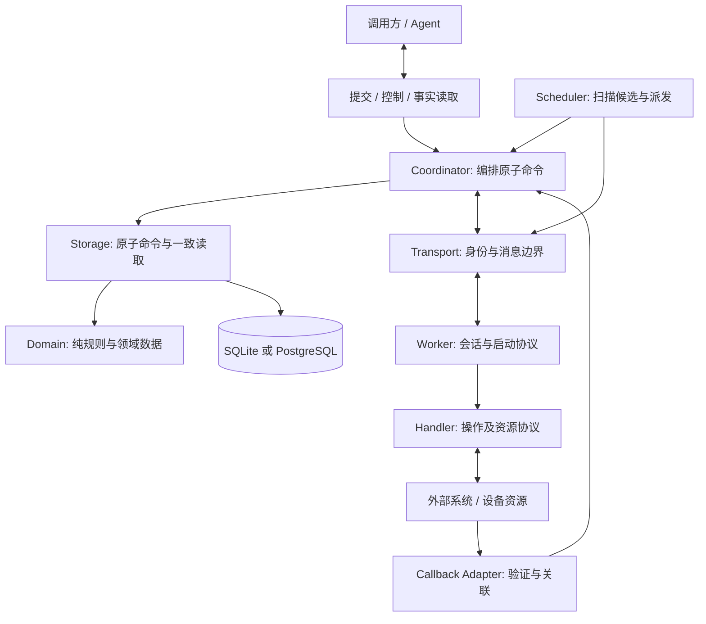
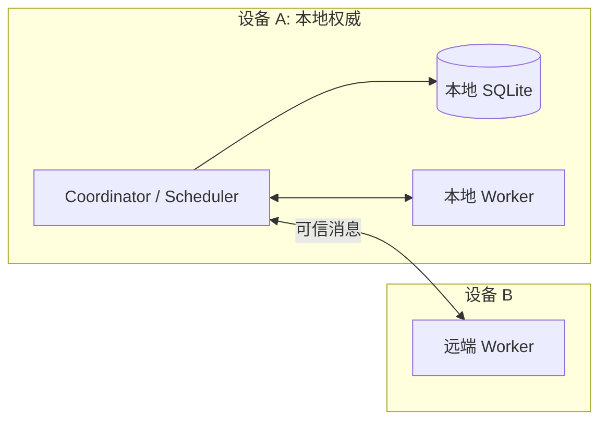
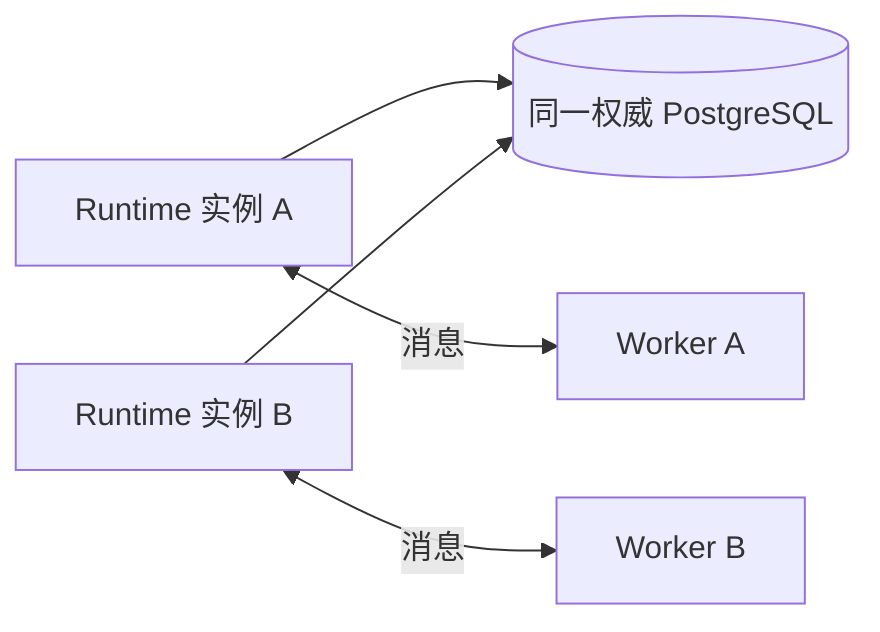

# Runtime 整体架构

状态: 既有核心决策的架构汇总, 加入待实现的组件契约. 图中是逻辑职责, 不规定一个职责对应一个进程或独立服务.
HTTP/RPC 协议, 公开 Behaviour 签名, 进程树和驱动版本仍需在实现前选择, 不由本图隐含批准.
范围见 [首版范围](first-release-scope.md), 理由见 [RFC 0001](../rfc/0001-core-boundaries.md).

## 1. 系统边界

Beamlet 接受独立 Effect 的可序列化描述, 管理执行尝试, 保存可信证据并接受唯一 Outcome.
Agent/业务层保存计算上下文, 依赖清单和下一步决策. 数据库持久性, 可信 Worker 与外部资源契约是可靠性的必要前提.

Authority 表示 Intent 的唯一逻辑裁决权, 不是图中必须新增的服务. 同一 collection 的 Coordinator
依据同一权威数据库处理命令. 多个 collection 可以分布在不同设备, 但首版不做跨 collection 事务, 自动发现或自动权威迁移.
业务层通过配置的集合路由和稳定 Intent 身份访问事实, 不直接处理 Worker 节点通信.

## 2. 组件契约与替换边界

| 组件 | 负责 | 不负责 |
| --- | --- | --- |
| Domain | 状态与资格规则, 显式命令/事实/时间/可信条件的纯决策 | Repo, 网络, 进程, 系统时钟 |
| Coordinator | 入域校验与调用原子 Storage 命令, 返回事实/拒绝/不确定响应 | 在事务外读快照后强行提交过期决定 |
| Storage | 在保护内读取, 取时, 重验, 更新与提交; 一致读取 | 外部调用, 让调用方用 CRUD 拼接领域事务 |
| Scheduler | 从持久候选发现工作, 匹配资源/Handler, 退避与尽力唤醒 | 持有唯一工作副本, 单凭队列或过期候选授予许可 |
| Transport | 编码, 连接, 认证身份与目标作用域映射, 消息投递 | 把发送成功当 Durable 确认, 把断连当 Failed |
| Worker | 新 incarnation, 领取/启动协议, 单许可不重入, 报告重投 | 直接写 Outcome, 重启继承旧 grant |
| Handler / Callback Adapter | 操作契约, 资源匹配, 外部键, 查询/回调证据与条件核验 | 无条件声明幂等, 任意修改原定义或授权新尝试 |
| 调用方便利层 | submit/read/wait, 持久关联后重建依赖结果 | 核心自动恢复调用栈, 等待超时制造终态 |

这些是接口义务, 不是要求创建通用插件注册平台. 首版可用静态配置; 增加替换实现时须跑同一符合性套件.
领域快照不包含 Ecto schema struct; Schema/Changeset 用于物理映射与基础验证, 不能替代跨实体领域守卫.
Repo/Adapter 提供事务机制, Storage 拥有领域原子边界. `Ecto.Multi` 可组织同事务写入, 但不能让外部调用参与 SQL 原子性,
也不能自动解决锁等待后的重验. PostgreSQL/SQLite 的实际事务形式见 [存储契约](storage-command-contracts.md).

## 3. 两种部署形态

本地 SQLite 由权威设备上的 Storage 使用; 远端 Worker 通过 Transport 请求命令/提交报告, 不在其他设备复制 SQLite
然后独立写入, 也不依靠网络共享 SQLite 文件实现多设备权威. 权威设备离线时, 其他 Worker 不自动获得该 collection
的结果提交权.

多实例共用 PostgreSQL 时, 数据库约束和同 Intent 保护保证提交顺序; 不要求全局 Coordinator leader.
扫描重复和派发重复允许存在, 合法领取/启动必须再次核验. 连接池, 扫描分片, 容量和吞吐量属于部署设计, 当前模型不证明其性能.
这两种形态可以有相同领域接口, 不意味着其物理写并行, 掉电或复制保证相同.

## 4. 最小消息协议

协议区分以下语义, 具体 push/pull 形式和 wire schema 待选择:

1. 派发候选只关联 collection/Intent/Execution 和资源要求, 不等于启动许可. 丢失后由持久重扫再发现.
2. 领取请求携带 Worker/incarnation 与观察到的 generation. 回复丢失恢复原分配, 不自动分配新代.
3. 启动请求以完整 token 申请许可; Authority 持久保存 grant, Handler/资源解释与完成关联后回复.
4. Worker 验证当前 incarnation 与完整目标作用域, 同一许可不主动重复调用. 无法确认自己是否调用过时进入恢复.
5. Report 和 Stored 回执保留稳定身份. Stored 仅表示证据提交, OutcomeAccepted 单独表达; 同内容重投不重复执行.
6. 通知仅唤醒调用方或扫描器; 重启必须能从持久事实取回结果和候选.

所有输入先验证协议版本, 预算和可信身份, 核心再验证领域关联和资格. namespace, Intent ID, correlation 不是凭据. 不默认使用
Distributed Erlang, HTTP, 队列或某个传输库. 任一实现均允许应用级重复/乱序/超时, 并保持命令原定重投语义. Transport
替换不改变 Submission/Report/Authorization 身份; 跨语言 Worker 使用受限逻辑消息, 不要求任意 Erlang term 的 wire 兼容.
首次网络集成前须选定认证, 版本协商, 重连, 大小限制和冲突拒绝协议; 未通过不能声称支持安全远端执行.

## 5. 故障时能够继续什么

| 情况 | 合法行为 | 不允许推断 |
| --- | --- | --- |
| Coordinator 重启, 权威库仍可用 | 重读已提交事实, 重扫工作, 返回原许可/结果 | 所有远端 lease 自动失效 |
| Worker 退出或设备离线 | 无授权 Prepared 可在旧领取失效后重领; 已授权尝试按证据恢复 | 未收到报告就是未执行 |
| 网络分区 | 未持久获许可不新调用; 已持有许可的旧会话可能调用, 外部运行可继续 | 断连证明外部停止, 另一节点可无条件接管 |
| Authority 不可达 | 结果可能暂无法入账; 已核验报告有保留者时等待重投, 否则披露 Unknown 风险 | 远端另建 Outcome 或回滚原外部调用 |
| 权威存储永久丢失 | 自动恢复没有保证; 运维须有另行验证的备份/权威交接协议 | Worker 可从内存重建全部权威事实 |
| 已提交 Outcome, 通知丢失 | 调用方用原稳定身份读取并复用 | 再次执行来补发结果 |

设备资源不能迁移时, 换 Worker 不意味着换资源; 见 [Handler 的执行环境契约](handler-recovery-contracts.md).
这里不承诺离线自治, 也不把保守等待称为 Liveness 保证.

## 6. 演进与验收

OTP 监督树负责进程生命周期, Storage 负责已提交事实. Coordinator/Scheduler 重读权威事实;
Worker 重启建立新会话, 不从存储复制旧 grant 为新调用许可. 调用方从其持久上下文和 Beamlet 的事实读取重建进度,
不恢复原进程内存. 进程内 ETS, 连接和任务表可以缓存, 不拥有权威事实. 不要求第一版就建设分布式 Actor 注册中心.

Operation 契约版本, Handler 发布号, 消息/codec 版本, 数据库 schema 版本和治理规则版本分别管理. 实现升级必须保留旧 Intent
的解释材料. 若不能提供兼容 Handler, 保持 Prepared/等待或按已授权事实恢复, 不静默迁移旧操作语义.
数据库迁移须另行验证旧快照读取和约束完整性; 首版不承诺任意运行中规则热更新或无停机迁移.

### 6.1 升级兼容的可测试行为

以下细化既有不静默改义原则, 不批准新的迁移框架. 每次发布须说明能读取的旧格式, 可执行的旧契约与不支持项.
只增加 Handler 发布号不自动允许修改已授权 binding, 外部 key scope 或原窗口.

| 变化/触发 | 要求的行为 | 验收断言 |
| --- | --- | --- |
| 同 Operation Identity 的兼容 Handler 修复 | 新尝试可选兼容发布; 旧尝试仍用已保存协议和原关联恢复 | 相同旧定义/结果保持含义, 原 grant 重投返回原快照; 已有 Handler 兼容/快照场景提供部分抽象证据 |
| Operation 改输入默认值, 账户解释或结果含义 | 不能覆盖原 Identity 的契约; 不兼容变化使用新 Identity | 同 key 携带新定义仍冲突, 不能将旧 Intent 自动改成新版本 |
| 新 Runtime 无法解释旧定义/状态/Report 格式 | 暴露不支持版本, 禁止受影响的写入/启动, 保留原持久事实 | 不重置为 Prepared, 不伪造 Failed, 不把未知旧枚举当默认值; 可提供不改义的诊断读取 |
| 已保存 Pending 的 Handler 暂缺 | 原绑定和等待关联保留; 可用兼容 Adapter 时继续核验原回调/查询 | 不重新创建审批或 Browser 会话; 不能仅因缺部署制造终态 |
| 仅增加可选诊断字段 | 格式升级须保留既有逻辑值, 身份相等性与原事实语义 | 前后读取定义相等, 同 key/同 Report 重投不新建; 缺省与 null 仍不同 |
| 核心启动/接受规则改变 | 发布须判定旧存量是否兼容, 不默认最新规则适用于全部旧快照 | 兼容路径跑旧场景和历史快照夹具; 不兼容存量在启用写入前需显式迁移或隔离处理 |
| History 理由/格式升级 | 保存解释版本与原依据, 新 reader 逐版本解释 | 不改写旧记录, 不重排已提交组, 未知理由不能被解释成当前规则已通过 |
| 数据库 schema 迁移失败或恢复旧备份 | 单独验证迁移原子性/恢复方案与权威身份连续性 | 不产生半迁移记录或失去唯一约束; 旧备份不能与原库同时作为同 collection 权威 |

旧数据兼容不限于 JSON 能解码: 还须保留身份比较, 资格, 结果含义, 外部关联与安全条件.
核心规则的不兼容升级可以要求停写/离线迁移, 当前不承诺任意热更新或无停机升级.
历史快照夹具, 真实 codec 与数据库迁移仍是后续实现证据, 当前 Quint 不验证任意存量迁移.

验收至少包括两种部署的完整调用链, 两个 Coordinator 同 Intent 竞争, 连接重建, 消息错路由/重投, 授权回复丢失,
共享 Worker 重启, 通知全丢重扫, 无兼容资源时不越权调用. 这些尚为工程验收要求, 不是现有 Quint 已证明的部署行为.
分阶段依赖与实现前决策见 [实现路线](implementation-roadmap.md), 当前抽象证据见 [覆盖文档](../quint/coverage.md).
